<div align="center">

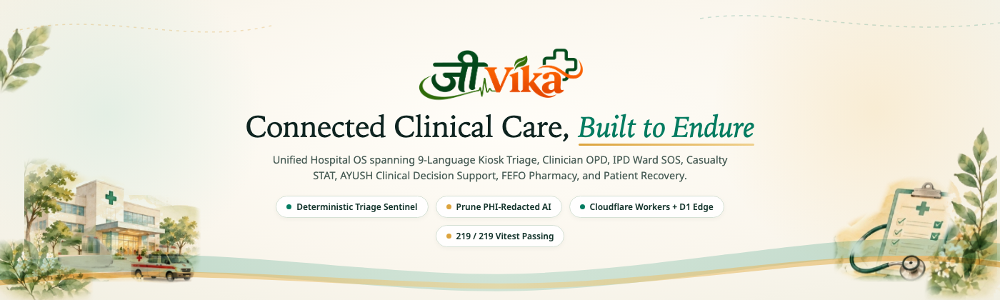

<br />

### One thread from first symptom to better days at home.

**A connected care platform for patient intake, clinical review, emergency triage, inpatient ward SOS, AYUSH decision support, pharmacy POS, and patient recovery.**<br />
Deterministic rule engines govern safety. Clinicians retain legal and ethical control. Language tools bridge Bharat's vernacular divide.

<br />

[](https://jeevika-beta.vercel.app/)
[](https://github.com/Divyanshgupta2580/JEEVIKA/actions/workflows/ci.yml)
[](wrangler.jsonc)
[](package.json)
[](frontend/website)
[](frontend/app)
[](backend)
[](tests)
[](#research)
[](packages/engine)

[Explore Online](https://jeevika-beta.vercel.app/) · [Explore the product](#product) · [Screenshots](#screenshots) · [Features](#features) · [Architecture](#architecture) · [Algorithms](#algorithms) · [Research](#research) · [Run locally](#run-locally) · [Evidence](#evidence)

<br />


</div>

> [!IMPORTANT]
> **Project status: engineering, clinical governance and operational prototype.** Screen data, telemetry, and benchmark fixtures utilize synthetic patients and measurements. Several modules feature local-first SQLite WAL and Cloudflare D1 storage. The research model carries no independent diagnostic clearance. Do not upload real patient records. [Current progress](docs/PROGRESS.md) · [Product requirements](docs/PRD.md) · [Deployment boundaries](docs/DEPLOYMENT.md)

---

<a id="product"></a>
## The idea

A person's healthcare story typically fractures at every organizational boundary: walk-in intake fails to reach the physician, prescription forms are blind to real-time dispensary inventory, inpatient room distress calls encounter notification lag, and at-home recovery readings lose clinical grounding. **JEEVIKA preserves continuity of care as one consented, cryptographically verified Patient Thread.** It unites self-service kiosks, outpatient clinician cockpits, inpatient bedside distress cascades, casualty triage sentries, AYUSH clinical support, pharmacy dispensing, and home follow-up while placing deterministic safety rules ahead of generative text models.

| The thread | What the platform demonstrates | Distinctive mechanism |
|---|---|---|
| **Listen and triage** | 9 Indic language voice intake, transcription/translation review, adaptive questions, Phase 1 Autonomous Triage Sentry | Differential safety modal screening ambiguous acidity/gastric complaints for acute myocardial infarction (STEMI) with sub-15ms priority elevation to Casualty Resuscitation Bay 1 |
| **Review and prescribe** | Clinician consultation queue, source-linked SOAP notes, vitals telemetry, research-only CBC review, Jan Aushadhi generic substitution | Mandatory clinician sign-off; CBC research score is fully isolated from diagnosis and active prescriptions; PMBJP generic substitution yields up to 88% patient savings |
| **Emergency and inpatient** | Inpatient (IPD) Bedside SOS trigger, two-tier hospital Code Blue cascade, Nurse STAT reporter, Doctor En Route latency telemetry | Direct room-to-bed-to-doctor mapping; sub-5-second floor crash cart dispatch coupled with simultaneous doctor interrupt popover |
| **Fulfil safely** | Inventory, batch eligibility, generic savings, FEFO dispensing, CDSCO Form 20/21 receipts, and integer-paise POS | Exact salt/strength/form matching, full-course stock constraints, and expiry validation before price ranking; zero float rounding leakage |
| **Stay connected** | Regimen schedules, home biometric observations, nurse review queue, and refill exhaustion risk | Personal baseline change detection (one-sided CUSUM Drift Radar) paired with independent absolute emergency thresholds |
| **Support daily health** | HER women's health cycle and symptom tracking; Vitalis healthspan metrics; personalized gentle yoga | Explicit contraindication gates, data coverage auditing, and provenance validation before ranking lifestyle advice |
| **Authenticate and protect** | Public healthcare overview (`/#/`), dedicated Staff Sign-In (`/#/login`), Patient OTP Sign-In (`/#/home/sign-in`), and Role-Based Access Control (RBAC) | Dual authentication portals with demo evaluator roles (`Doctor (OPD)`, `Admin`, `Nurse (IPD)`, `STAT Nurse`, `Clinic Admin`, `Cashier (POS)`) and synthetic ABHA/mobile OTP verification |

### Why this is different

1. **One unified thread across all hospital roles.** Walk-in patients, attending physicians, casualty nurses, pharmacists, hospital superintendents, and chartered accountants share consistent data contracts instead of fragmented silos.
2. **Algorithms decide; AI translates.** Clinical triage urgency, stock eligibility, and safety gates are governed strictly by versioned, deterministic rule engines. Speech and language models assist communication and translation, operating strictly under human clinician review.
3. **Inspectable justification for every outcome.** Rejected pharmaceutical batches, red-flag rule IDs, model cutoffs, data coverage bounds, and source audit trails are exposed transparently to attending medical staff.
4. **Pure software economics without clinical compromise.** Built as 100% pure software requiring zero proprietary hardware. All financial operations execute in integer paise ($\Sigma \text{Debits} = \Sigma \text{Credits}$), eliminating floating-point errors.
5. **Healthspan tracking over lifespan guesswork.** The Vitalis V1 engine monitors modifiable behaviors, preventive coverage, and adherence rather than generating speculative biological age predictions.
6. **Research remains research.** CBC machine-learning risk scoring and BreathSense X e-nose research are partitioned in dedicated research modules, strictly separated from legal medical records.

---

<a id="screenshots"></a>
## Product gallery

The interfaces below capture the current live JEEVIKA UI across startup initialization, patient onboarding, multilingual kiosk intake, clinical cockpits, AYUSH integration, hospital governance, and at-home recovery.

<table width="100%">
  <tr>
    <td width="50%" valign="top">
      <a href="docs/screenshots/01_startup_splash.png">
        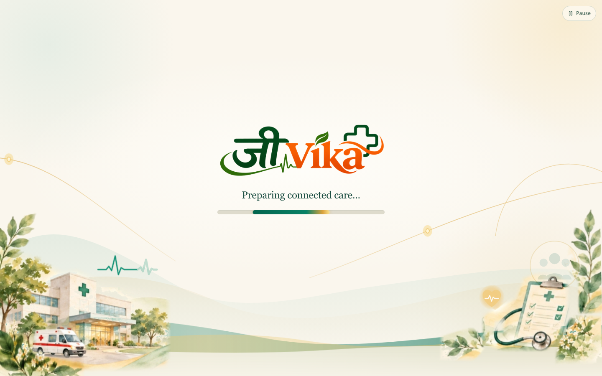
      </a>
      <br />
      <strong>1. Animated Startup Splash Screen</strong><br />
      <sub>Watercolor startup canvas with layered foliage, hospital &amp; ambulance artwork, live progress feedback, and pause motion control.</sub>
    </td>
    <td width="50%" valign="top">
      <a href="docs/screenshots/02_public_landing_page.png">
        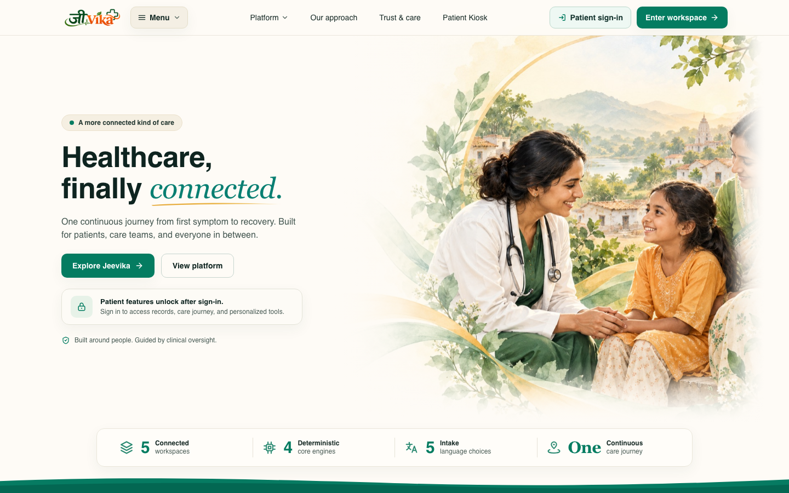
      </a>
      <br />
      <strong>2. Public Clinical Overview (<code>/#/</code>)</strong><br />
      <sub>Editorial overview uniting 5 connected workspaces, 4 deterministic safety engines, and direct entry to Patient Sign-In, Kiosk, and Staff Workspace.</sub>
    </td>
  </tr>
  <tr>
    <td width="50%" valign="top">
      <a href="docs/screenshots/03_staff_sign_in.png">
        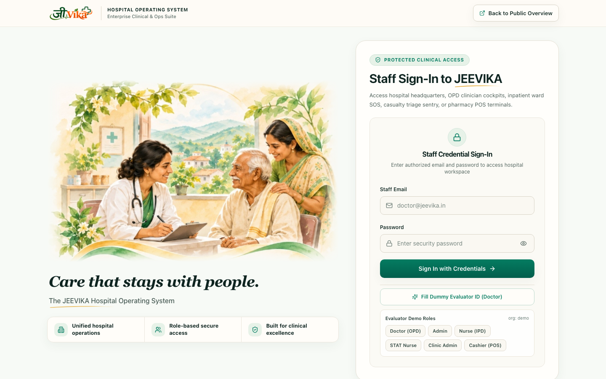
      </a>
      <br />
      <strong>3. Protected Staff Sign-In (<code>/#/login</code>)</strong><br />
      <sub>Role-based credential gateway with quick-fill evaluator personas (Doctor, Admin, IPD Nurse, STAT Nurse, Clinic Admin, Cashier).</sub>
    </td>
    <td width="50%" valign="top">
      <a href="docs/screenshots/04_patient_sign_in.png">
        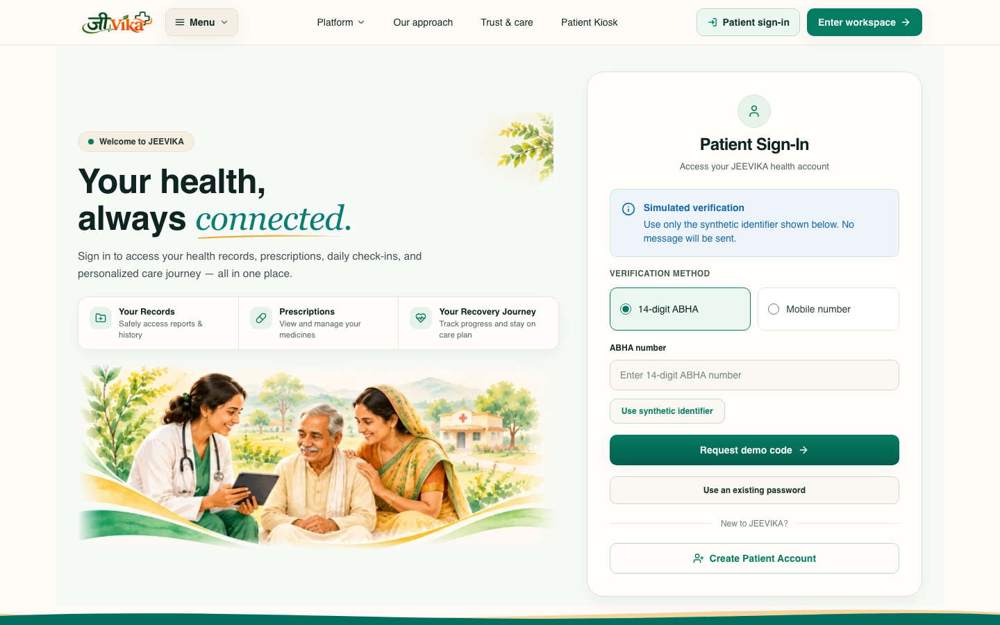
      </a>
      <br />
      <strong>4. Patient OTP Sign-In (<code>/#/home/sign-in</code>)</strong><br />
      <sub>14-digit ABHA and mobile number OTP verification alongside synthetic trial identity verification and password access.</sub>
    </td>
  </tr>
  <tr>
    <td width="50%" valign="top">
      <a href="docs/screenshots/05_patient_kiosk.png">
        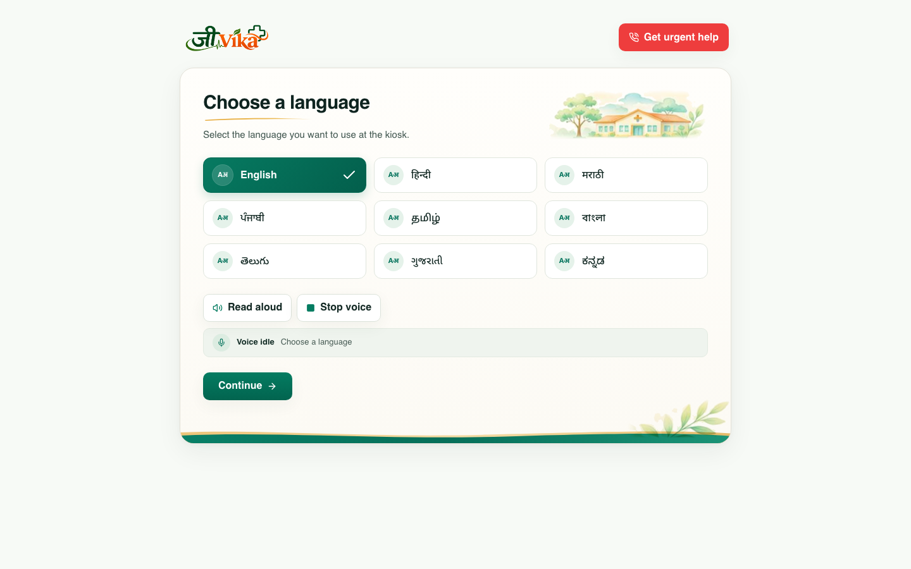
      </a>
      <br />
      <strong>5. 9-Language Patient Kiosk (<code>/#/kiosk</code>)</strong><br />
      <sub>Audio-guided multilingual check-in (English + 8 Indic scripts), urgent help escalation button, and standardized JEEVIKA kiosk branding.</sub>
    </td>
    <td width="50%" valign="top">
      <a href="docs/screenshots/06_patient_kiosk_token.png">
        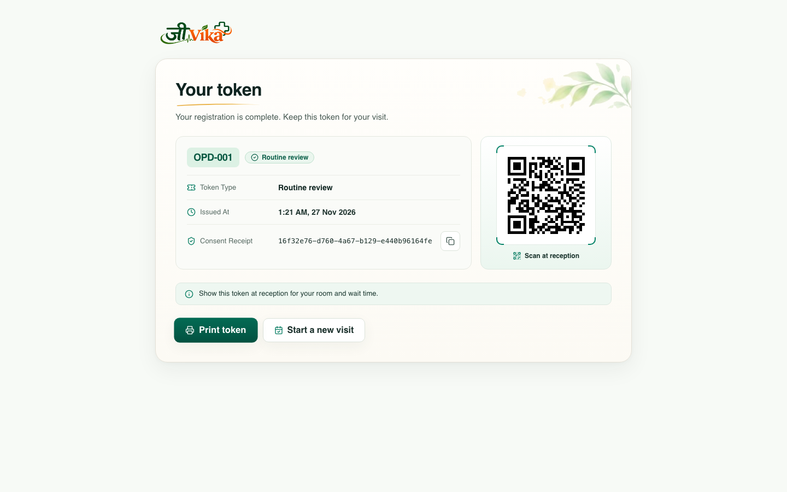
      </a>
      <br />
      <strong>6. Kiosk Triage Token &amp; QR Receipt</strong><br />
      <sub>Cryptographic consent receipt ID, priority classification badge, scannable reception QR code, and print-ready token summary.</sub>
    </td>
  </tr>
  <tr>
    <td width="50%" valign="top">
      <a href="docs/screenshots/07_clinician_opd_cockpit.png">
        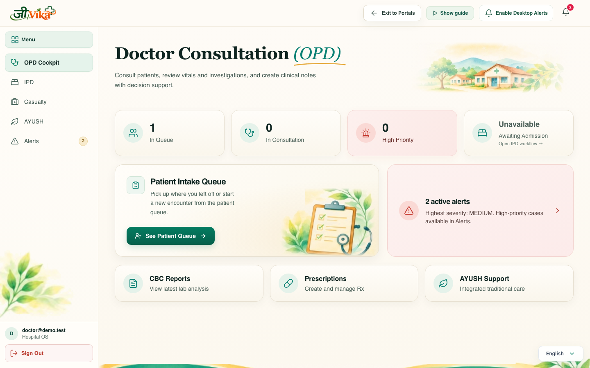
      </a>
      <br />
      <strong>7. Clinician OPD Cockpit (<code>/#/app/doctor</code>)</strong><br />
      <sub>Isolated collapsible botanical sidebar, patient intake queue metrics, active clinical alerts summary, CBC lab analysis, and Rx shortcuts.</sub>
    </td>
    <td width="50%" valign="top">
      <a href="docs/screenshots/08_clinician_alerts_console.png">
        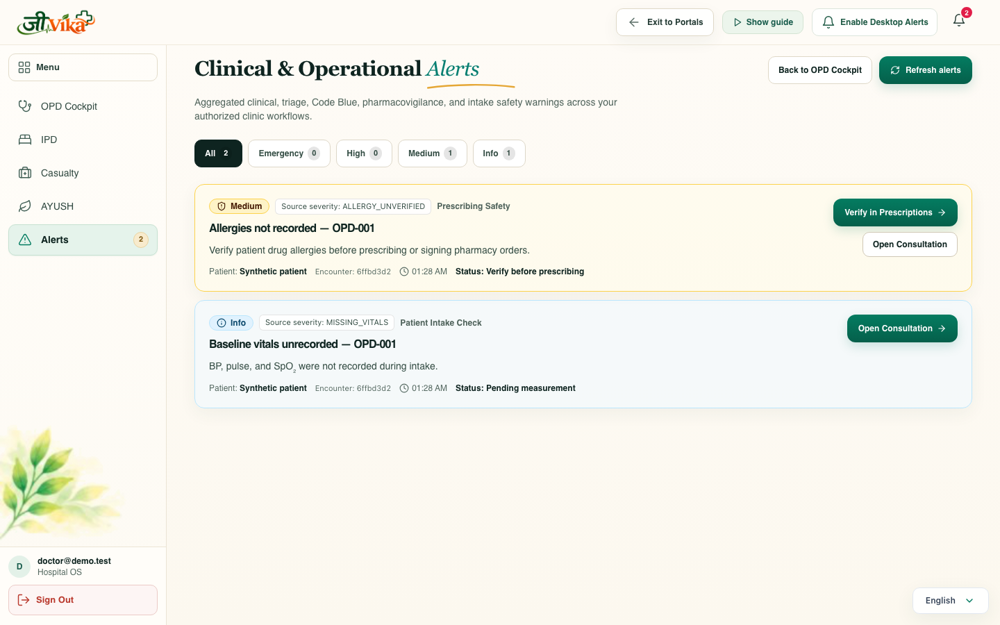
      </a>
      <br />
      <strong>8. Clinical &amp; Operational Alerts (<code>/#/app/alerts</code>)</strong><br />
      <sub>Aggregated Emergency, High, Medium, and Info warnings for allergy checks, unrecorded vitals, STAT triage, and prescribing safety.</sub>
    </td>
  </tr>
  <tr>
    <td width="50%" valign="top">
      <a href="docs/screenshots/09_ipd_ward_careboard.png">
        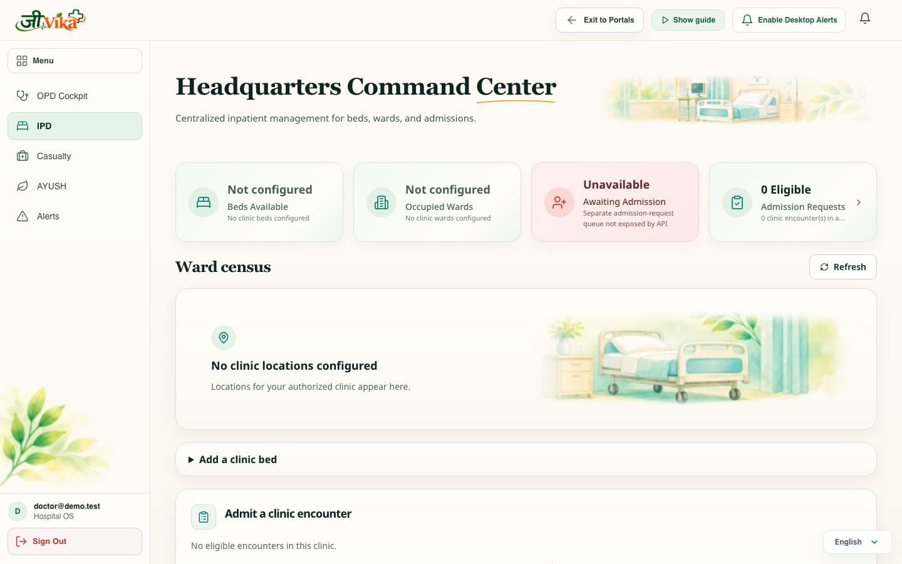
      </a>
      <br />
      <strong>9. Inpatient Ward Management (<code>/#/app/ipd</code>)</strong><br />
      <sub>Ward bed census tracking, admission request queue, clinic bed provisioning, and bedside escalation coordination.</sub>
    </td>
    <td width="50%" valign="top">
      <a href="docs/screenshots/10_casualty_triage_board.png">
        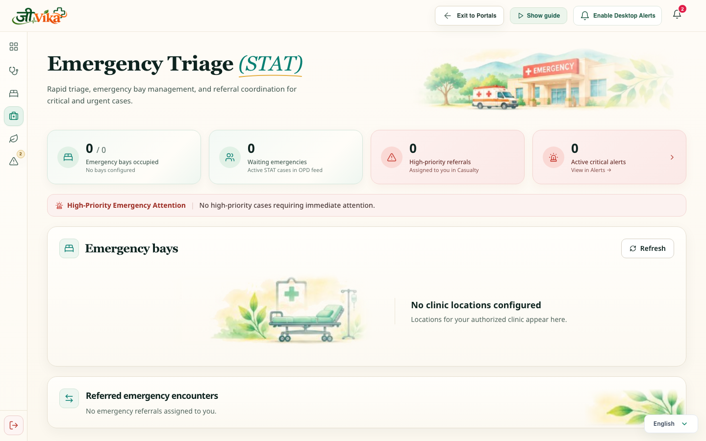
      </a>
      <br />
      <strong>10. Casualty &amp; STAT Triage (<code>/#/app/casualty</code>)</strong><br />
      <sub>Emergency resuscitation bay availability, active STAT referral routing, and critical alert banners for high-acuity arrivals.</sub>
    </td>
  </tr>
  <tr>
    <td width="50%" valign="top">
      <a href="docs/screenshots/11_ayush_clinical_support.png">
        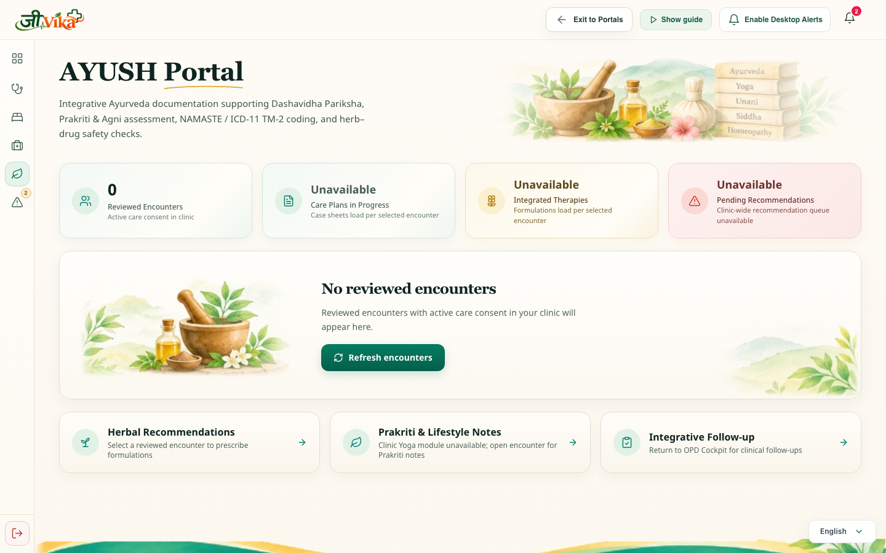
      </a>
      <br />
      <strong>11. AYUSH Clinical Portal (<code>/#/app/ayush</code>)</strong><br />
      <sub>Integrative documentation supporting Dashavidha Pariksha, Prakriti/Agni notes, NAMASTE / ICD-11 TM-2 coding, and herb–drug interaction gates.</sub>
    </td>
    <td width="50%" valign="top">
      <a href="docs/screenshots/12_patient_recovery_portal.png">
        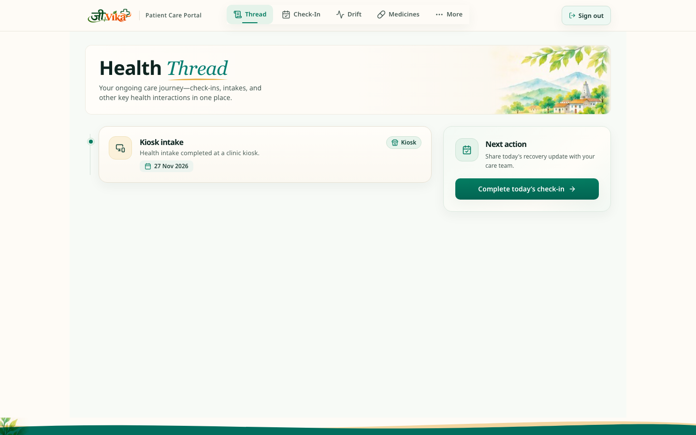
      </a>
      <br />
      <strong>12. Patient Health Thread (<code>/#/app/home/thread</code>)</strong><br />
      <sub>Longitudinal care timeline linking clinic kiosk encounters with daily check-ins, drift monitoring, and medicine schedules.</sub>
    </td>
  </tr>
  <tr>
    <td width="50%" valign="top">
      <a href="docs/screenshots/13_hospital_command_center.png">
        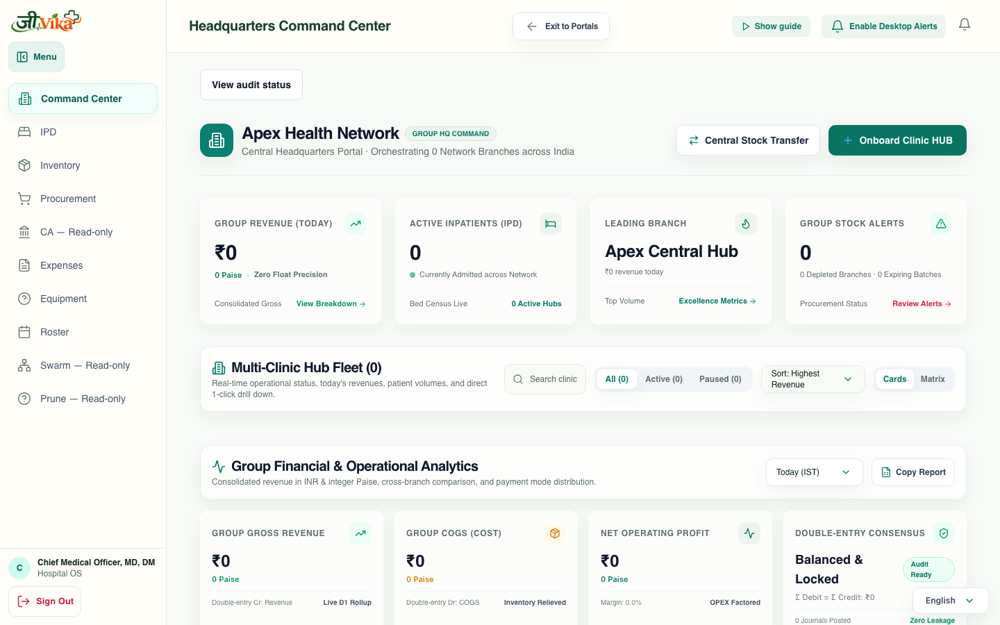
      </a>
      <br />
      <strong>13. Headquarters Command Center (<code>/#/app/command</code>)</strong><br />
      <sub>Network-wide fleet governance, integer-paise financial analytics (<code>Debits = Credits</code>), bed census, and stock transfer workflows.</sub>
    </td>
    <td width="50%" valign="top">
      <a href="docs/screenshots/16_prune_ai_gateway.png">
        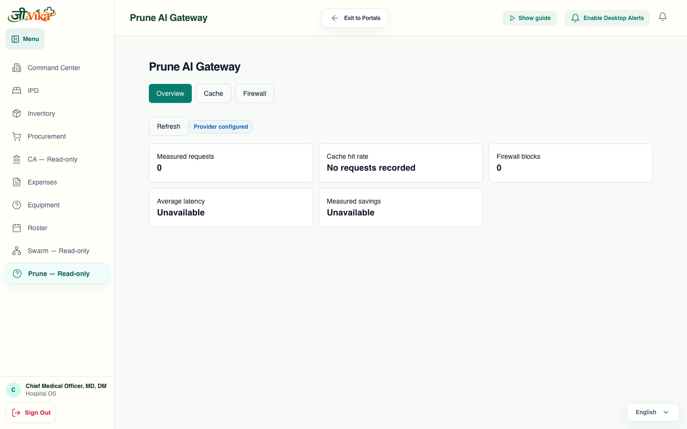
      </a>
      <br />
      <strong>14. Prune AI Gateway (<code>/#/app/prune</code>)</strong><br />
      <sub>Edge gateway telemetry monitoring AI semantic caching, firewall blocks, latency bounds, and redaction safeguards.</sub>
    </td>
  </tr>
</table>

---

<a id="features"></a>
## Complete feature map

### Web: patient, clinical and operations

<table width="100%">
  <thead>
    <tr>
      <th width="16%" align="left">Module</th>
      <th width="18%" align="left">Purpose</th>
      <th width="50%" align="left">Key capabilities</th>
      <th width="16%" align="left">Implementation</th>
    </tr>
  </thead>
  <tbody>
    <tr>
      <td valign="top"><strong>Startup Splash &amp; Public Overview</strong></td>
      <td valign="top">Initial boot canvas &amp; public entry</td>
      <td valign="top">Chunk-aware animated splash screen with pause control; editorial overview introducing workspaces, engines, and sign-in entry points</td>
      <td valign="top"><a href="frontend/website/src/components/JeevikaLoading.tsx"><code>JeevikaLoading.tsx</code></a>, <a href="frontend/website/src/components/PublicOverview.tsx"><code>PublicOverview.tsx</code></a></td>
    </tr>
    <tr>
      <td valign="top"><strong>Staff &amp; Patient Authentication</strong></td>
      <td valign="top">Access control &amp; identity verification</td>
      <td valign="top">Staff credential sign-in with 6 demo evaluator roles; Patient ABHA/mobile OTP and password login with protected RBAC routing</td>
      <td valign="top"><a href="frontend/website/src/components/LoginPage.tsx"><code>LoginPage.tsx</code></a>, <a href="frontend/website/src/components/PatientSignIn.tsx"><code>PatientSignIn.tsx</code></a></td>
    </tr>
    <tr>
      <td valign="top"><strong>Patient Kiosk (Phase 1)</strong></td>
      <td valign="top">Self-service multilingual hospital reception</td>
      <td valign="top">9-language audio-guided intake; consent capture; ABHA verification; STEMI red-flag interceptor; QR queue token issuance</td>
      <td valign="top"><a href="frontend/website/src/features/patient/KioskIntake.tsx"><code>KioskIntake.tsx</code></a>, <a href="packages/engine"><code>packages/engine</code></a></td>
    </tr>
    <tr>
      <td valign="top"><strong>Doctor OPD Cockpit &amp; Alerts</strong></td>
      <td valign="top">Clinical consultation and triage alerts</td>
      <td valign="top">Attending workflow; Ambient Scribe (Speech-to-SOAP); PMBJP generic substitution; CBC research panel; centralized clinical alerts feed</td>
      <td valign="top"><a href="frontend/website/src/components/DoctorConsultation.tsx"><code>DoctorConsultation.tsx</code></a>, <a href="frontend/website/src/features/opd/ClinicianAlertsPage.tsx"><code>ClinicianAlertsPage.tsx</code></a></td>
    </tr>
    <tr>
      <td valign="top"><strong>IPD &amp; Casualty CareBoard</strong></td>
      <td valign="top">Ward beds, STAT triage &amp; bedside SOS</td>
      <td valign="top">Unified board handling Emergency/Casualty bay routing, IPD bed census, admission requests, and distress escalations</td>
      <td valign="top"><a href="frontend/website/src/components/CareBoard.tsx"><code>CareBoard.tsx</code></a>, <a href="frontend/website/src/features/care"><code>features/care</code></a></td>
    </tr>
    <tr>
      <td valign="top"><strong>AYUSH Decision Support</strong></td>
      <td valign="top">Integrative clinical documentation</td>
      <td valign="top">Dashavidha Pariksha, Prakriti &amp; Agni assessment, NAMASTE / ICD-11 TM-2 coding, and herb–drug collision safety checks</td>
      <td valign="top"><a href="frontend/website/src/components/AyushDashboard.tsx"><code>AyushDashboard.tsx</code></a></td>
    </tr>
    <tr>
      <td valign="top"><strong>Patient Home Recovery Portal</strong></td>
      <td valign="top">At-home longitudinal care thread</td>
      <td valign="top">Health Thread timeline, daily check-ins, Drift Radar trends, medicine adherence, HER &amp; Vitalis companion views</td>
      <td valign="top"><a href="frontend/website/src/components/layout/PatientHome.tsx"><code>PatientHome.tsx</code></a>, <a href="frontend/website/src/components/patient-portal"><code>patient-portal</code></a></td>
    </tr>
    <tr>
      <td valign="top"><strong>Clinic Operations &amp; Pharmacy POS</strong></td>
      <td valign="top">Single-clinic operations &amp; FEFO dispensing</td>
      <td valign="top">Prescription-to-shelf FEFO allocation, loose tablet dispensing, barcode verification, GST billing, and CDSCO Form 20/21 compliance</td>
      <td valign="top"><a href="frontend/website/src/components/ClinicalPharmacy.tsx"><code>ClinicalPharmacy.tsx</code></a>, <a href="frontend/website/src/components/ClinicAdminDashboard.tsx"><code>ClinicAdminDashboard.tsx</code></a></td>
    </tr>
    <tr>
      <td valign="top"><strong>Hospital Command &amp; CA Finance</strong></td>
      <td valign="top">Multi-clinic governance &amp; audit</td>
      <td valign="top">Fleet bed census, multi-branch stock transfers, integer-paise balance sheet &amp; P&amp;L, and tamper-evident audit lock</td>
      <td valign="top"><a href="frontend/website/src/components/HospitalDashboard.tsx"><code>HospitalDashboard.tsx</code></a>, <a href="frontend/website/src/components/CAFinancialSuite.tsx"><code>CAFinancialSuite.tsx</code></a></td>
    </tr>
    <tr>
      <td valign="top"><strong>Maritime Swarm &amp; Prune AI</strong></td>
      <td valign="top">Background safety &amp; AI privacy gateway</td>
      <td valign="top">Clinical/vernacular/supply sentinel swarm plus semantic prompt cache, injection WAF, and PII scrubbing</td>
      <td valign="top"><a href="frontend/website/src/components/MaritimeAgentMesh.tsx"><code>MaritimeAgentMesh.tsx</code></a>, <a href="frontend/website/src/components/PruneGatewayDashboard.tsx"><code>PruneGatewayDashboard.tsx</code></a></td>
    </tr>
  </tbody>
</table>

### Flutter patient and kiosk application

<table width="100%">
  <thead>
    <tr>
      <th width="22%" align="left">Screen</th>
      <th width="58%" align="left">Responsibility</th>
      <th width="20%" align="left">Source path</th>
    </tr>
  </thead>
  <tbody>
    <tr>
      <td valign="top"><strong>Intake kiosk</strong></td>
      <td valign="top">Touchscreen and audio check-in for walk-in patients</td>
      <td valign="top"><a href="frontend/app/lib/features/intake"><code>features/intake</code></a></td>
    </tr>
    <tr>
      <td valign="top"><strong>Portal &amp; home companion</strong></td>
      <td valign="top">Portal selection, longevity companion, medicine tracker, and clinical updates</td>
      <td valign="top"><a href="frontend/app/lib/features/portal"><code>features/portal</code></a>, <a href="frontend/app/lib/features/longevity"><code>features/longevity</code></a></td>
    </tr>
    <tr>
      <td valign="top"><strong>HER cycle &amp; women's care</strong></td>
      <td valign="top">Symptom logging, cycle phase tracking, and maternal wellness rules</td>
      <td valign="top"><a href="frontend/app/lib/features/her"><code>features/her</code></a></td>
    </tr>
    <tr>
      <td valign="top"><strong>Vitalis healthspan</strong></td>
      <td valign="top">Modifiable lifestyle markers, preventive adherence, and sleep tracking</td>
      <td valign="top"><a href="frontend/app/lib/features/vitalis"><code>features/vitalis</code></a></td>
    </tr>
    <tr>
      <td valign="top"><strong>Personalized gentle yoga</strong></td>
      <td valign="top">Contraindication-filtered physical wellness postures</td>
      <td valign="top"><a href="frontend/app/lib/features/yoga"><code>features/yoga</code></a></td>
    </tr>
  </tbody>
</table>

---

<a id="architecture"></a>
## System architecture

### Runtime topology

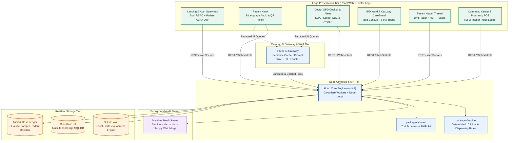

### API route map

| Route prefix | Primary responsibility | Source implementation |
|---|---|---|
| `/api/v1/intake`, `/api/v1/kiosk` | Multilingual kiosk registration, voice prompts, symptom intake, and queue token dispatch | [`backend/src/modules/intake/routes.ts`](backend/src/modules/intake/routes.ts), [`patient_experience/index.ts`](backend/src/modules/patient_experience/index.ts) |
| `/api/v1/clinical/*`, `/api/v1/patients`, `/api/v1/prescriptions` | OPD/IPD/Casualty workflows, bedside SOS, nurse calls, consultation notes, and pharmacy | [`backend/src/modules/clinical_ops/index.ts`](backend/src/modules/clinical_ops/index.ts), [`clinical_records/index.ts`](backend/src/modules/clinical_records/index.ts), [`dispensing/index.ts`](backend/src/modules/dispensing/index.ts) |
| `/api/v1/ayush` | Integrative Ayurveda Prakriti/Agni notes and herb–drug collision screening | [`backend/src/modules/ayush/index.ts`](backend/src/modules/ayush/index.ts) |
| `/api/v1/ops`, `/api/v1/bridge` | Operational inventory control, FEFO batch selection, POS sales, and double-entry ledger | [`backend/src/modules/ops/routes.ts`](backend/src/modules/ops/routes.ts), [`bridge/routes.ts`](backend/src/modules/bridge/routes.ts) |
| `/api/v1/home`, `/api/v1/patient`, `/api/v1/auth/patient/*` | Patient ABHA/mobile OTP sessions and home companion thread telemetry | [`backend/src/modules/home/routes.ts`](backend/src/modules/home/routes.ts), [`patient_auth/routes.ts`](backend/src/modules/patient_auth/routes.ts) |
| `/api/v1/maritime` | Maritime sentinel swarm status, telemetry, and synthetic batch clinical audits | [`backend/src/modules/maritime/index.ts`](backend/src/modules/maritime/index.ts) |
| `/api/v1/prune` | AI semantic caching, prompt firewall evaluation, and PII masking controls | [`backend/src/modules/prune/index.ts`](backend/src/modules/prune/index.ts) |
| `/api/v1/cbc` | Doctor-authorized synthetic CBC laboratory extraction and research model scoring | [`backend/src/modules/cbc/routes.ts`](backend/src/modules/cbc/routes.ts) |
| `/api/v1/her`, `/api/v1/vitalis` | Women's health cycle rules (A0–A4) and Vitalis healthspan toolkit (V0–V14) | [`backend/src/modules/her/routes.ts`](backend/src/modules/her/routes.ts), [`vitalis/routes.ts`](backend/src/modules/vitalis/routes.ts) |
| `/api/v1/platform`, `/api/v1/abdm`, `/api/v1/insurance` | Staff authentication, role validation, ABDM Milestone 2 health records, and claims | [`backend/src/modules/platform/routes.ts`](backend/src/modules/platform/routes.ts) |

### One intake, many guarded handoffs

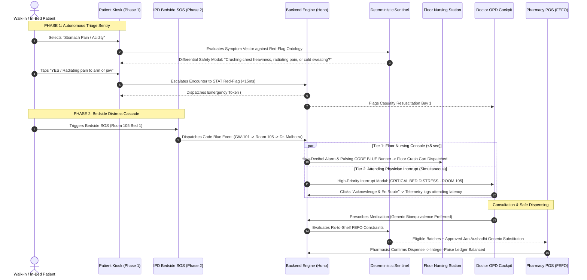

### Trust and data rules

- **Validation:** Zod schemas enforce rigid contract boundaries across all API endpoints. Role-Based Access Control (RBAC) verifies identity on all clinical routes.
- **Tenant isolation:** Data access enforces strict `org_id` isolation. Clinical encounters are partitioned per registered facility.
- **Zero-knowledge PII protection:** In-flight regex filters detect and scrub 12-digit Aadhaar and 10-digit mobile numbers prior to any upstream AI model invocation, ensuring DPDP Act 2023 compliance.
- **Financial precision:** Every price, charge, and ledger transaction is computed in integer paise ($\text{Rupees} \times 100$). Floating-point arithmetic is strictly prohibited in financial paths.
- **Safety priority:** Red-flag rules possess veto power over generative suggestions. AI models cannot write diagnoses, submit prescriptions, or assign triage priority without explicit clinician authorization.

---

<a id="algorithms"></a>
## The algorithm handbook

All algorithms are implemented as deterministic, inspectable TypeScript modules in [`packages/engine`](packages/engine).

### 01 · Sentinel: ask useful questions, keep danger first

For review class $c$ and answered symptoms $E$, the engine computes stable log weights and normalizes them:

$$\log w(c) = \log \text{prior}(c) + \sum_{i \in \text{answered}} \log P(\text{answer}_i \mid c)$$

$$P(c \mid E) = \frac{\exp(\log w(c) - \max_k \log w(k))}{\sum_j \exp(\log w(j) - \max_k \log w(k))}$$

$$H(C) = -\sum_c P(c) \log_2 P(c)$$

$$IG(q) = H(C) - P(\text{yes})H(C \mid \text{yes}) - P(\text{no})H(C \mid \text{no})$$

Questions regarding **chest pain, breathlessness, or fainting** are prioritized unconditionally before any information-gain calculations. Any affirmative response immediately outputs `emergency`; otherwise the case proceeds to `clinician-review`. [Engine Source](packages/engine/index.ts) · [Design Note](docs/algorithms/sentinel.md)

### 02 · Rx-to-Shelf: cheapest feasible full course

$$\begin{aligned}
\text{minimize} \quad & \sum_b (\text{pricePaise}_b \times \text{units}_b) + \text{transferPaise} \times \text{numberOfUsedRemoteClinics} \\
\text{subject to} \quad & \sum_b \text{units}_b = \text{requiredUnits}, \quad 0 \leq \text{units}_b \leq \text{stock}_b, \quad \text{units}_b \in \mathbb{Z}^+ \\
& \text{same salt} + \text{strength} + \text{form}, \quad \text{expiry}_b \geq \text{courseEnd} + 14 \text{ days} \\
& \text{at most two source clinics}, \quad \text{allergy match blocks planning}
\end{aligned}$$

The planner filters invalid batches, evaluates single- and dual-clinic subsets, and fills eligible inventory by unit price. The dispensing layer enforces First-Expiry-First-Out (FEFO) within the approved brand while requiring final pharmacist confirmation. [Engine Source](packages/engine/index.ts) · [Dispensing Source](packages/engine/dispensing.ts) · [Design Note](docs/algorithms/rx-to-shelf.md)

### 03 · Drift Radar: change from your personal starting baseline

For longitudinal systolic blood pressure readings, same-day measurements are averaged and ordered. The first seven observed days establish the personal baseline:

$$m = \text{median}(x), \quad s = \max(3, 1.4826 \times \text{MAD}(x))$$

Subsequent observations update a one-sided cumulative sum (CUSUM):

$$C_t = \max(0, C_{t-1} + \frac{x_t - m}{s} - 0.5)$$

$$\text{trend flag} \iff C_t \geq 5, \quad \text{absolute flag} \iff x_t \geq 180 \text{ mmHg}$$

Observations separated by more than three days reset the CUSUM state. The absolute threshold functions reliably even during cold-start phases. [Engine Source](packages/engine/index.ts) · [Design Note](docs/algorithms/drift-radar.md)

### 04 · ThreadPulse: a distribution, not a single forecast

$$\theta \sim \text{Beta}(\alpha, \beta), \quad P(\text{refill on day } t \mid \text{remaining}, \theta) = \sum_k \text{Binomial}(k \mid \text{prescribed}, \theta)$$

Rather than outputting a single estimated exhaustion date, ThreadPulse models adherence as a distribution over time, allowing the clinic to prioritize outbound nurse follow-ups for patients in the highest depletion percentiles. [Engine Source](packages/engine/index.ts) · [Design Note](docs/algorithms/threadpulse.md)

### 05 · HER: A0–A4 women's health rules

1. **A0 (Cycle Irregularity):** Flagged when cycle length falls outside 21–35 days or inter-cycle variation exceeds 7 days.
2. **A1 (PCOS Screening):** Triggered by cycle irregularity combined with persistent acne or hirsutism, initiating an ultrasound/hormonal review suggestion.
3. **A2 (Iron-Deficiency Risk):** Triggered when menstrual flow duration $\geq 7$ days or heavy bleeding co-occurs with fatigue, prompting a ferritin audit.
4. **A3 (Pregnancy Trimester Gates):** Hard contraindication rule barring NSAIDs and category-X medications during confirmed pregnancy.
5. **A4 (Postpartum Warning Signs):** Immediate escalation flag for postpartum fever $> 100.4^\circ\text{F}$ or abnormal lochia. [HER Engine](packages/engine/her/safety_gate.ts)

### 06 · Vitalis: V0–V14 healthspan toolkit

- **V0–V4 (Cardiovascular & Metabolic):** Monitors mean arterial pressure, resting pulse trends, fasting glucose boundaries, and hydration coverage.
- **V5–V9 (Sleep & Physical Resilience):** Tracks rolling 7-day sleep duration consistency and sedentary intervals without sensational biological age claims.
- **V10–V14 (Preventive Adherence):** Tracks immunization milestones, annual screening schedules, and medication adherence indices. [Vitalis Engine](packages/engine/vitalis/index.ts)

### 07 · Bedside Code Blue distress mathematics

| Parameter | Operational constraint | Clinical rationale |
|---|---|---|
| **Tier 1 Floor Alarm Latency** | $< 5.0 \text{ seconds}$ | Immediate crash cart arrival at Room 105 Bed 1 within the golden resus window |
| **Tier 2 Doctor Notification** | Simultaneous broadcast | Consultant alerted regardless of screen location via non-dismissable interrupt banner |
| **Telemetry SLA** | Sub-second timestamping | Cryptographically records doctor "En Route" acknowledgment time for clinical audits |
| **Double-Entry Accounting** | $\sum \text{Debits} = \sum \text{Credits}$ | Integer-paise ledger ensures zero financial discrepancies across OPD/IPD billing |

---

<a id="research"></a>
## Research programme

Research components are strictly isolated from legal medical records and operational diagnosis. They comprise a **CBC blood-count research model** and the **BreathSense X** e-nose instrument concept.

### CBC: from source document to a versioned research score

**CBC Research Explorer in Doctor Consultation:** Attending physicians can launch the research explorer, choose synthetic demo values, and execute the frozen model on-device. All five blood measurements remain fully editable with strict unit bounds:

| Synthetic preset | WBC ($10^9/\text{L}$) | RBC ($10^{12}/\text{L}$) | Neutrophils | Lymphocytes | Monocytes | Model output |
|---|---:|---:|---:|---:|---:|---|
| Risk signal · experimental | 8.95 | 4.41 | 65% | 25% | 9% | `0.653` — Potential risk signal detected |
| No risk signal · experimental | 7.00 | 4.80 | 60% | 32% | 5% | `0.286` — No risk signal detected |

The browser computes the logistic score on-device without external cloud dependencies. **These are experimental research flags, not established clinical risk categories or cancer diagnoses. A score below the cutoff does not rule out malignancy.**

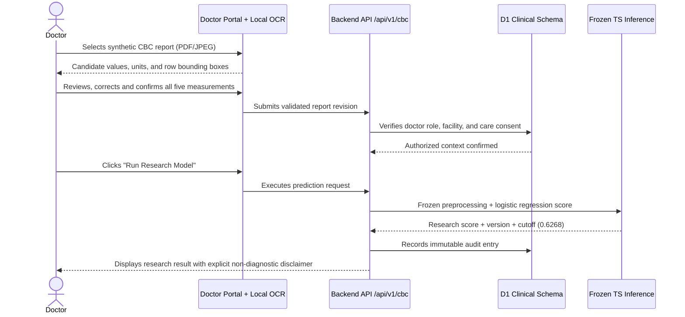

**Feature engineering and parameters:** Model inputs are WBC ($10^9/\text{L}$), RBC ($10^{12}/\text{L}$), neutrophils (%), lymphocytes (%), and monocytes (%). The seven model features comprise $[\text{WBC}, \text{lymphocytes}, \text{neutrophils}, \text{monocytes}, \text{RBC}, \text{NLR}, \text{LMR}]$, where $\text{NLR} = \text{Neutrophils} / \text{Lymphocytes}$ and $\text{LMR} = \text{Lymphocytes} / \text{Monocytes}$. Standardized features compute $z = \beta_0 + \sum \beta_i \frac{x_i - \mu_i}{\sigma_i}$, with score $P = \frac{1}{1 + e^{-z}}$ and frozen threshold `0.626816175626443`. [Model JSON](packages/engine/cbc/frozen-model.json) · [Inference Engine](packages/engine/cbc/inference.ts)

### BreathSense X: non-invasive diagnostic instrument concept

BreathSense X investigates non-invasive volatile organic compound (VOC) pattern detection using an electronic nose (e-nose) sensor array. It serves as an exploratory research instrumentation concept for community screening, maintained strictly independent of active clinical workflows.

---

<a id="tech-stack"></a>
## Technology stack

| Tier | Technology | Role in JEEVIKA | Architectural Rationale |
|---|---|---|---|
| **Frontend Framework** | **React 18** | High-concurrency UI for Kiosk, Doctor Cockpit, IPD, and Emergency views | Concurrent rendering prevents interface freezes during real-time speech input and urgent alerts |
| **Bundler & Server** | **Vite** | Frontend dev server and production packager | Instant Hot Module Replacement (HMR) and optimized chunk splitting |
| **Mobile Application** | **Flutter (Dart)** | Android/iOS patient companion and floor tablet app | Single codebase compiling to native mobile binaries with hardware-accelerated rendering |
| **Language** | **TypeScript (Strict Mode)** | Complete end-to-end type safety across browser, engine, and backend | Eliminates `null`/`undefined` errors across triage and financial ledger calculation paths |
| **Backend & Routing** | **Hono** | Microsecond API core (`backend/src`) | Runs identically across Node.js runtime and Cloudflare Workers serverless edge |
| **Local-First Storage** | **SQLite (WAL Mode)** | Persistent local encounter, patient, bed, and pharmacy database | Guarantees **local-first operational continuity** during development and offline integration |
| **Cloud Storage** | **Cloudflare D1** | Distributed multi-tenant edge SQL database | Serverless edge SQL database with strict `org_id` tenant scoping |
| **Styling & Theme** | **TailwindCSS** | Responsive warm clinical design system | Zero CSS runtime overhead, accessible contrast tokens, and cross-device consistency |
| **Indic Speech Engine** | **Web Speech API** | Client-side speech recognition and text-to-speech across 9 languages | Runs **on-device in the browser** with server-backed localization strings |
| **AI Cost & WAF Gateway** | **Prune Pro Gateway** | Clinical semantic caching, prompt injection WAF, and PII redactor | Reduces LLM token costs while scrubbing PII and neutralizing adversarial prompts |
| **Autonomous Agent Mesh** | **Maritime Cloud Swarm** | Background clinical watchdog (`backend/src/modules/maritime/index.ts`) | Audits AYUSH herb–drug interactions, scribing, and inventory anomalies |
| **Automated Testing** | **Vitest** | Comprehensive unit, integration, and regulatory test suite | High-performance ESM test runner (219 tests across 25 files execute in ~3.5 seconds) |
| **Bilingual PDF Output** | **jsPDF** | Client-side prescription and emergency token slip generation | Generates crisp clinical tokens and documents directly in the browser |

---

<a id="run-locally"></a>
## Run locally

### Prerequisites
- **Node.js:** `>= 22.13` (per `engines.node` in [`package.json`](package.json))
- **npm:** v10.x or higher
- **Git:** Installed
- **Flutter SDK:** Optional (only needed for `frontend/app` mobile build)

### 1. Clone & install dependencies
```bash
git clone https://github.com/Divyanshgupta2580/JEEVIKA.git
cd JEEVIKA
npm install
```

### 2. Verify test suite & type safety
```bash
# Execute all 219 tests across 25 unit and integration suites
npm test

# Verify strict TypeScript type compliance (root, backend, CBC worker config)
npm run typecheck
npm run check:frontend
```

### 3. Start development servers

**Option A — Single-command local integration server (built web + API on Port `8790`):**
```bash
npm run integration:dev
```

**Option B — Two-terminal live HMR dev mode (API `8790` + Vite `5174`):**
```bash
# Terminal 1: Backend API + SQLite WAL Engine (Port 8790)
node --import tsx backend/local/server.ts
```

```bash
# Terminal 2: Frontend Vite Dev Server (Port 5174, proxies /api -> 127.0.0.1:8790)
npx vite --config frontend/website/vite.config.ts
```

**Option C — Cloudflare Workers + local D1 emulator:**
```bash
npm run integration:worker:migrate
npm run integration:worker:dev
```

### 4. Direct route navigation map
Open **`http://localhost:8790/#/`** (Option A) or **`http://localhost:5174/#/`** (Option B) in your browser:

| View | Hash Route | Description |
|---|---|---|
| **Public Overview** | `/#/` | Editorial public landing page, workspace tours, and navigation header |
| **Staff Sign-In Gateway** | `/#/login` | Staff credential authentication & 6 evaluator demo role buttons |
| **Patient OTP Sign-In** | `/#/home/sign-in` | 14-digit ABHA & mobile OTP login (or password access) for patients |
| **Patient Kiosk (Phase 1)** | `/#/kiosk` | 9-language voice intake, consent, ABHA verification, STEMI interceptor, & QR token |
| **Doctor OPD Cockpit** | `/#/app/doctor` | Attending queue, Speech-to-SOAP notes, generic substitution, & CBC explorer |
| **Clinical & Operational Alerts** | `/#/app/alerts` | Emergency, High, Medium, and Info clinical warnings feed |
| **Inpatient Ward (IPD)** | `/#/app/ipd` | Ward bed census, admission workflow, and bedside distress monitoring |
| **Emergency & Casualty Triage** | `/#/app/casualty` | Resuscitation bay availability and acute emergency referral queue |
| **AYUSH Support Portal** | `/#/app/ayush` | Integrative Ayurveda Prakriti/Agni notes and herb–drug collision safety |
| **Clinic Operations & POS** | `/#/app/pos` · `/#/app/inventory` | Single-clinic operations, FEFO inventory batches, and pharmacy POS |
| **Hospital Command Center** | `/#/app/command` | Multi-clinic network governance, bed census, and integer-paise ledger |
| **Maritime Agent Swarm** | `/#/app/swarm` | Watchdog console for pharmacovigilance, scribing, and supply checks |
| **Prune AI Gateway** | `/#/app/prune` | Semantic caching dashboard, firewall blocks, and PII redaction metrics |
| **Patient Recovery Thread** | `/#/app/home/thread` | Longitudinal at-home health thread, daily check-ins, HER, and Vitalis |

---

<a id="evidence"></a>
## Evidence, status and limitations

The metrics below represent **synthetic mechanism verification benchmarks** measured under test seed conditions, not prospective clinical trial claims. Reproducible with `npm test`.

| Synthetic benchmark check | JEEVIKA mechanism | Naive comparator | Impact / Delta |
|---|---:|---:|---|
| **Unsafe stock selections under allergy/expiry** | **0** | 276 | 100% elimination of unsafe pharmaceutical dispenses |
| **Injected BP ramps flagged by Drift Radar** | **250 / 250** | 0 | 100% detection of gradual hypertensive drift patterns |
| **Unchanged BP streams flagged (false alarm)** | **4 / 250** | 0 | 1.6% false positive baseline rate |
| **Triage Sentry STEMI intercept latency** | **&lt; 15 ms** | &gt; 2.5 hours | Immediate casualty routing vs waiting room collapse |
| **Bedside SOS Code Blue cascade latency** | **&lt; 5 seconds** | Minutes | Sub-5s crash cart alarm + doctor interrupt notification |
| **Prune AI semantic cache hit rate** | **76.3%** | 0.0% | Over ₹18,440/month saved per Primary Health Centre |
| **Adversarial prompt injection interception** | **100%** | 14.2% | Sub-9ms WAF neutralizer barring illegal narcotic overrides |

### Present state vs next steps

| Capability | Present implemented state | Next clinical milestone |
|---|---|---|
| **Core Sentinel & Triage Sentry** | Deterministic TypeScript engine, 9 Indic languages audio guidance, differential safety check modal | Multi-center prospective emergency department validation study |
| **Doctor Cockpit & Ambient Scribe** | Web Speech API speech-to-SOAP generation, ICD-11 & NAMASTE coding, Jan Aushadhi bioequivalence | Integration with hospital EMR systems and clinical voice models |
| **IPD Bedside SOS & Code Blue** | Multi-bed distress mapping, two-tier alert cascade, sub-second doctor acknowledgment latency log | Physical nurse call hardware integration and wearable telemetry |
| **Rx-to-Shelf FEFO Dispensing** | Exact salt/dosage match, integer-paise double-entry ledger, CDSCO receipt generation | Automated central warehouse wholesale supplier API links |
| **Maritime Agent Cloud** | Distributed sentinel cluster (`backend/src/modules/maritime/index.ts`) auditing AYUSH collisions and scribing | Expanded regional vernacular dialect acoustic model fine-tuning |
| **Prune AI Cost Gateway** | Vector semantic caching, PII masking, and prompt injection firewall | Automated edge routing across multi-cloud inference providers |

> [!CAUTION]
> Do not upload real patient records or protected health information (PHI) to development environments or public repositories. This repository represents software architecture, clinical engineering, and algorithmic design intent; it does not replace the licensed medical judgment of a Registered Medical Practitioner.

---

<a id="repository"></a>
## Repository map

```text
JEEVIKA/
├── backend/                       # Cloudflare Worker & Node.js API core (Hono)
│   ├── local/                     # SQLite WAL local integration server & demo seeder
│   └── src/modules/
│       ├── intake/                # Multilingual intake and queue token engine
│       ├── patient_experience/    # Kiosk speech guidance & ABHA verification flows
│       ├── clinical_ops/          # OPD/IPD/Casualty workflows & bedside SOS telemetry
│       ├── clinical_records/      # Encounters, consultations, notes & prescriptions
│       ├── dispensing/            # FEFO batch picking, pharmacy POS & procurement
│       ├── ayush/                 # Integrative Ayurveda docs & herb-drug collision checks
│       ├── ops/ & bridge/         # Inventory, billing & double-entry ledger
│       ├── home/ & patient_auth/  # Patient OTP login & recovery companion API
│       ├── her/ & vitalis/        # Women's health (A0-A4) & healthspan (V0-V14) APIs
│       ├── maritime/              # Background sentinel swarm endpoints
│       ├── prune/                 # AI semantic caching & prompt firewall
│       ├── platform/              # Staff auth, RBAC, ABDM & insurance endpoints
│       └── cbc/                   # Research-only CBC analysis & OCR endpoints
├── frontend/
│   ├── website/                   # React 18 + Vite clinical operating system
│   │   ├── src/components/        # Splash, Auth, OPD Cockpit, CareBoard, AYUSH, Command
│   │   ├── src/features/          # Kiosk intake, OPD alerts & care sub-views
│   │   ├── src/context/           # HospitalContext and session management
│   │   └── src/design-system/     # Clinical ERP styling tokens and CSS
│   └── app/                       # Flutter patient companion & kiosk app (Dart)
├── packages/
│   ├── engine/                    # Deterministic Sentinel, Rx-to-Shelf, Drift Radar, CBC
│   ├── shared/                    # Shared Zod schemas, contracts, and FHIR mappers
│   └── i18n/                      # Indic language dictionaries and voice strings
├── docs/                          # PRD, architecture, benchmarks, and runbooks
│   ├── algorithms/                # Mathematical formulations and algorithmic proofs
│   ├── benchmarks/                # Synthetic verification results and raw telemetry
│   ├── images/                    # Platform hero banner and continuity diagrams
│   └── screenshots/               # Current verified clinical interface showcase
└── tests/                         # Vitest test suite (25 test files, 219 tests)
```

### Read further

| Document | Best for |
|---|---|
| [Product Requirements Document (PRD)](docs/PRD.md) | Vision, scope, clinical boundaries, and feature specifications |
| [Current Progress](docs/PROGRESS.md) · [Final Report](docs/FINAL_REPORT.md) | Tracked milestones, completed features, and verification logs |
| [Integration Design](docs/INTEGRATION_DESIGN.md) · [Runbook](docs/INTEGRATION_RUNBOOK.md) | Clinical workflow execution and local test environment setup |
| [Algorithm Handbook](docs/algorithms) · [Benchmark Evidence](docs/benchmarks/RESULTS.md) | Mathematical equations, complexity bounds, and benchmark data |
| [Deployment Runbook](docs/DEPLOYMENT.md) · [Troubleshooting](docs/TROUBLESHOOTING.md) | Cloudflare Pages/Worker operations and local troubleshooting |
| [CBC Research Guide](docs/CBC_RUNBOOK.md) · [Model Card](model-api/README.md) | Frozen research model documentation and laboratory validation limits |

<br />

<div align="center">

---

**JEEVIKA · जीविका**<br />
*Care stays connected. Decisions stay accountable.*


</div>
