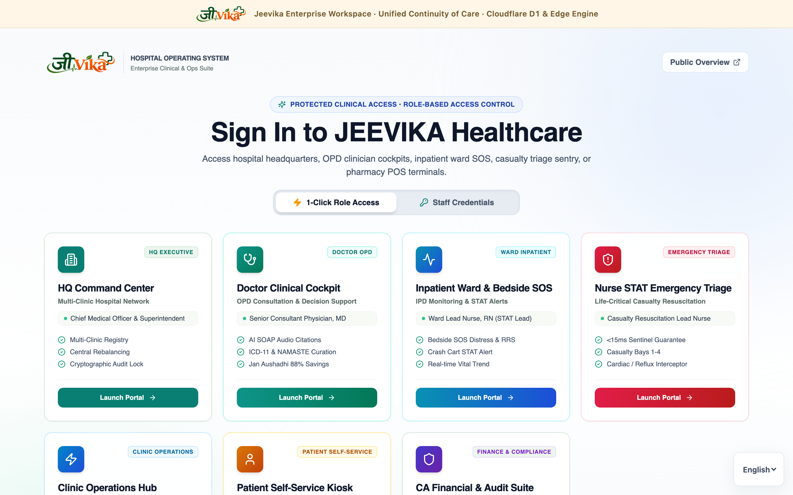
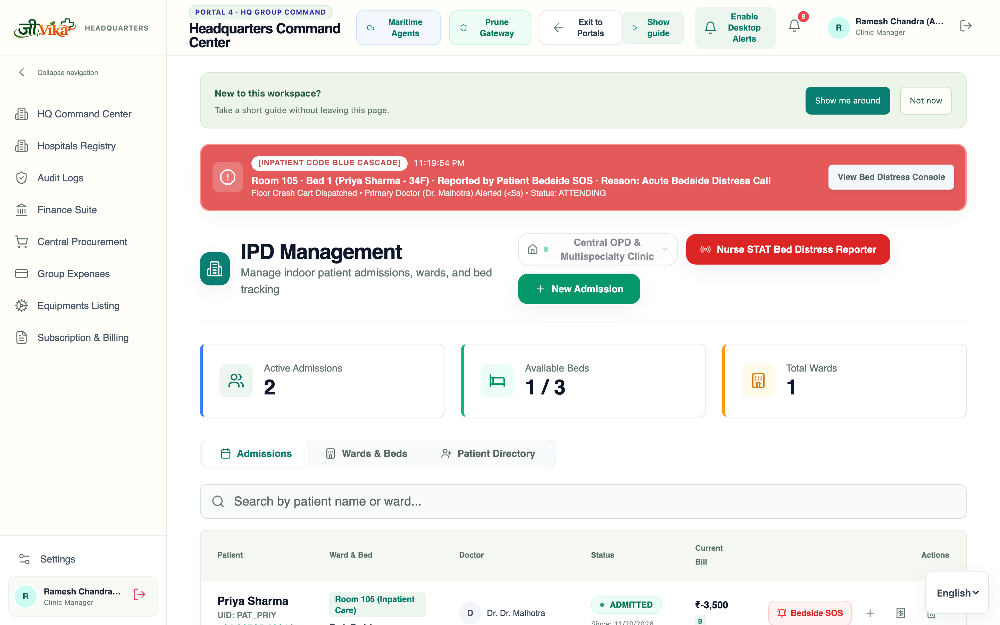
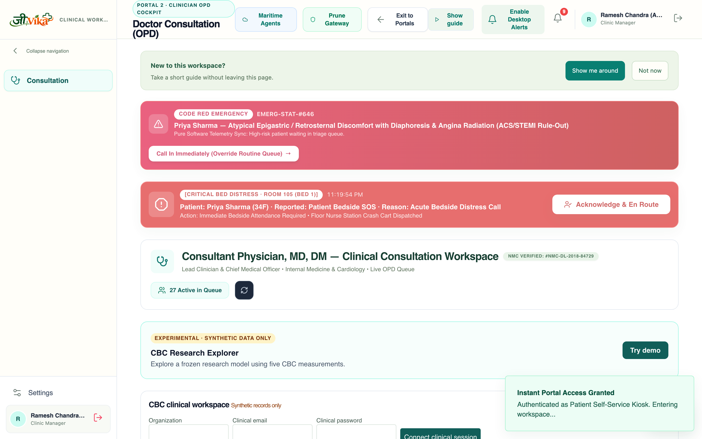
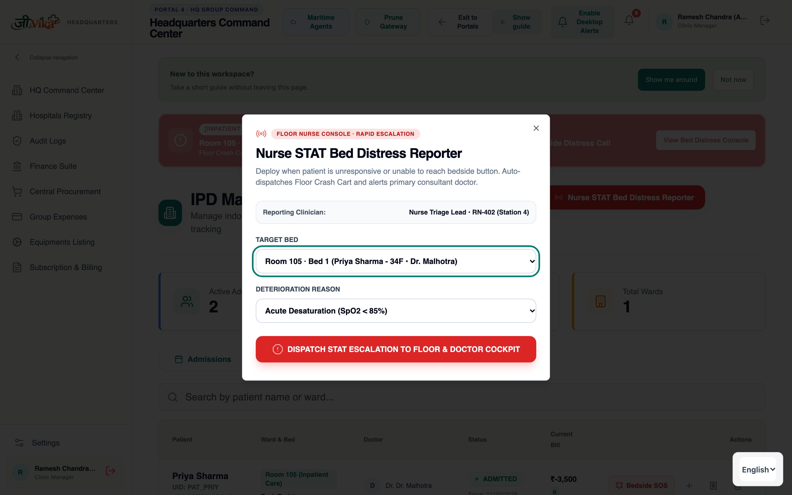
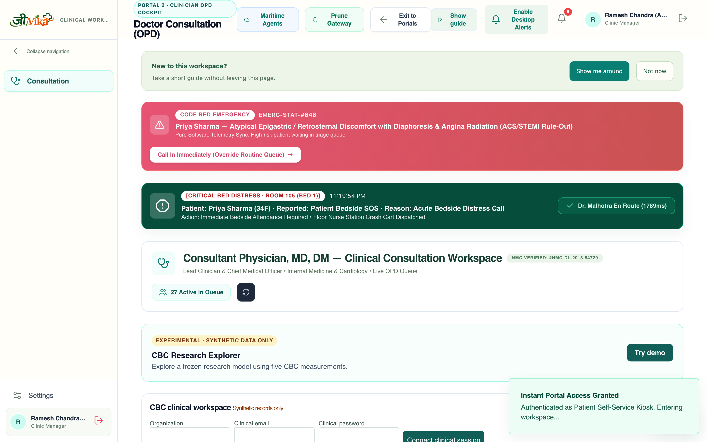
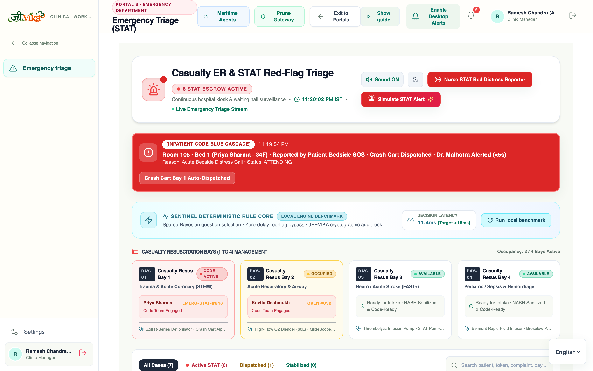
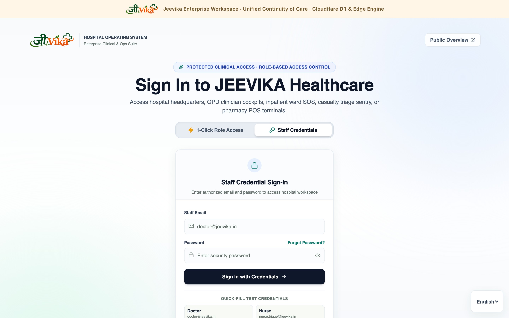
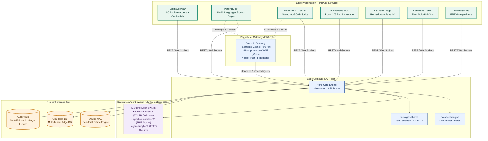
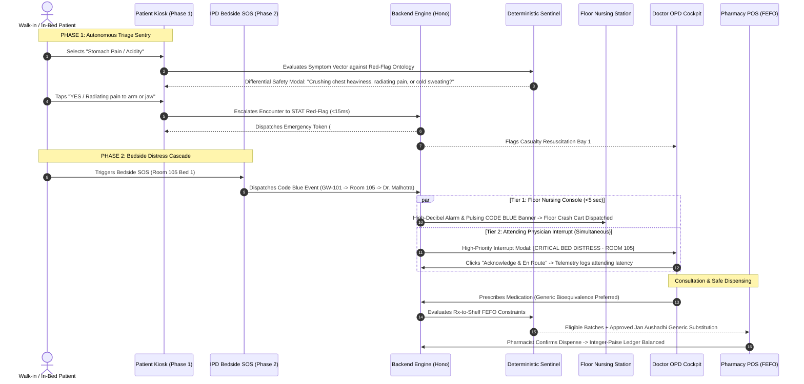
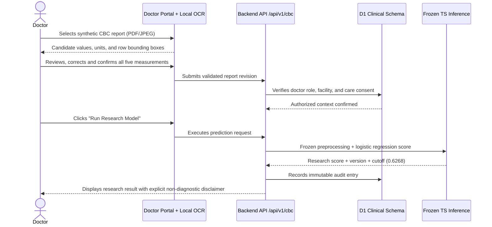

<div align="center">


<br />

### One thread from first symptom to better days at home.

**A connected care platform for patient intake, clinical review, emergency triage, inpatient ward SOS, pharmacy POS, and hospital operations.**<br />
Deterministic rule engines govern safety. Clinicians retain legal and ethical control. Language tools bridge Bharat's vernacular divide.

<br />

[](https://github.com/Divyanshgupta2580/JEEVIKA/actions/workflows/ci.yml)
[](wrangler.jsonc)
[](package.json)
[](frontend/website)
[](frontend/app)
[](backend)
[](tests)
[](#research)
[](packages/engine)

[Explore the product](#product) · [Screenshots](#screenshots) · [Features](#features) · [Architecture](#architecture) · [Algorithms](#algorithms) · [Research](#research) · [Run locally](#run-locally) · [Evidence](#evidence)

<br />


</div>

> [!IMPORTANT]
> **Project status: engineering, clinical governance and operational prototype.** Screen data, telemetry, and benchmark fixtures utilize synthetic patients and measurements. Several modules feature local-first SQLite WAL and Cloudflare D1 storage. The research model carries no independent diagnostic clearance. Do not upload real patient records. [Current progress](docs/PROGRESS.md) · [Product requirements](docs/PRD.md) · [Deployment boundaries](docs/DEPLOYMENT.md)

---

<a id="product"></a>
## The idea

A person's healthcare story typically fractures at every organizational boundary: walk-in intake fails to reach the physician, prescription forms are blind to real-time dispensary inventory, inpatient room distress calls encounter notification lag, and at-home recovery readings lose clinical grounding. **JEEVIKA preserves continuity of care as one consented, cryptographically verified Patient Thread.** It unites self-service kiosks, outpatient clinician cockpits, inpatient bedside distress cascades, casualty triage sentries, pharmacy dispensing, and home follow-up while placing deterministic safety rules ahead of generative text models.

| The thread | What the platform demonstrates | Distinctive mechanism |
|---|---|---|
| **Listen and triage** | 9 Indic language voice intake, transcription/translation review, adaptive questions, Phase 1 Autonomous Triage Sentry | Differential safety modal screening ambiguous acidity/gastric complaints for acute myocardial infarction (STEMI) with sub-15ms priority elevation to Casualty Resuscitation Bay 1 |
| **Review and prescribe** | Clinician consultation queue, source-linked SOAP notes, vitals telemetry, research-only CBC review, Jan Aushadhi generic substitution | Mandatory clinician sign-off; CBC research score is fully isolated from diagnosis and active prescriptions; PMBJP generic substitution yields up to 88% patient savings |
| **Emergency and inpatient** | Inpatient (IPD) Bedside SOS trigger, two-tier hospital Code Blue cascade, Nurse STAT reporter, Doctor En Route latency telemetry | Direct room-to-bed-to-doctor mapping (`Room 105 Bed 1` $\rightarrow$ `Priya Sharma` $\rightarrow$ `Dr. Malhotra`); sub-5-second floor crash cart dispatch coupled with simultaneous doctor interrupt popover |
| **Fulfil safely** | Inventory, batch eligibility, generic savings, FEFO dispensing, CDSCO Form 20/21 receipts, and integer-paise POS | Exact salt/strength/form matching, full-course stock constraints, and expiry validation before price ranking; zero float rounding leakage |
| **Stay connected** | Regimen schedules, home biometric observations, nurse review queue, and refill exhaustion risk | Personal baseline change detection (one-sided CUSUM Drift Radar) paired with independent absolute emergency thresholds |
| **Support daily health** | HER women's health cycle and symptom tracking; Vitalis healthspan metrics; personalized gentle yoga | Explicit contraindication gates, data coverage auditing, and provenance validation before ranking lifestyle advice |
| **Authenticate and protect** | Dedicated default Login Page, Role-Based Access Control (RBAC), and session protection across all clinical paths | Dual-mode authentication: 1-Click Role Access for 7 operational personas and Staff Credential login with demo quick-fill pills |

### Why this is different

1. **One unified thread across all hospital roles.** Walk-in patients, attending physicians, casualty nurses, pharmacists, hospital superintendents, and chartered accountants share consistent data contracts instead of fragmented silos.
2. **Algorithms decide; AI translates.** Clinical triage urgency, stock eligibility, and safety gates are governed strictly by versioned, deterministic rule engines. Speech and language models assist communication and translation, operating strictly under human clinician review.
3. **Inspectable justification for every outcome.** Rejected pharmaceutical batches, red-flag rule IDs, model cutoffs, data coverage bounds, and source audit trails are exposed transparently to attending medical staff.
4. **Pure software economics without clinical compromise.** Built as 100% pure software requiring zero proprietary hardware. All financial operations execute in integer paise ($\Sigma \text{Debits} = \Sigma \text{Credits}$), eliminating floating-point errors.
5. **Healthspan tracking over lifespan guesswork.** The Vitalis V1 engine monitors modifiable behaviors, preventive coverage, and adherence rather than generating speculative biological age predictions.
6. **Research remains research.** CBC machine-learning risk scoring and BreathSense X e-nose research are partitioned in dedicated research modules, strictly separated from legal medical records.

---

<a id="screenshots"></a>
## Product gallery

The interfaces below demonstrate JEEVIKA's clinical design system: high-contrast typography, accessible color accents, responsive layout geometry, and zero-clash modal layers.

<table width="100%" style="border-collapse: separate; border-spacing: 16px; margin: 16px 0;">
  <tr>
    <td width="50%" align="center" valign="top" style="background: #f8fafc; border: 1px solid #e2e8f0; border-radius: 12px; padding: 14px;">
      <a href="docs/screenshots/01_desktop_login_page.png" target="_blank">
        
      </a>
      <div style="padding-top: 12px; text-align: left;">
        <strong>1. Protected Authentication Gateway</strong><br />
        <span style="font-size: 12px; color: #64748b;">Default entry route featuring 1-Click Role Access across 7 hospital personas and Staff Credential sign-in.</span>
      </div>
    </td>
    <td width="50%" align="center" valign="top" style="background: #f8fafc; border: 1px solid #e2e8f0; border-radius: 12px; padding: 14px;">
      <a href="docs/screenshots/02_patient_kiosk.png" target="_blank">
        
      </a>
      <div style="padding-top: 12px; text-align: left;">
        <strong>2. Patient Intake Kiosk (Phase 1)</strong><br />
        <span style="font-size: 12px; color: #64748b;">Autonomous Clinical Triage Sentry, 9 Indic languages audio guidance, and 1-Click ABHA QR scan.</span>
      </div>
    </td>
  </tr>
  <tr>
    <td width="50%" align="center" valign="top" style="background: #f8fafc; border: 1px solid #e2e8f0; border-radius: 12px; padding: 14px;">
      <a href="docs/screenshots/08_differential_triage_interceptor.png" target="_blank">
        
      </a>
      <div style="padding-top: 12px; text-align: left;">
        <strong>3. Differential Triage Interceptor</strong><br />
        <span style="font-size: 12px; color: #64748b;">Intercepts ambiguous gastric/acidity complaints to prevent STEMI heart attack waiting room deaths.</span>
      </div>
    </td>
    <td width="50%" align="center" valign="top" style="background: #f8fafc; border: 1px solid #e2e8f0; border-radius: 12px; padding: 14px;">
      <a href="docs/screenshots/09_stat_resuscitation_token.png" target="_blank">
        
      </a>
      <div style="padding-top: 12px; text-align: left;">
        <strong>4. STAT Emergency Token (#EMERG)</strong><br />
        <span style="font-size: 12px; color: #64748b;">Instant sub-15ms priority elevation routed directly to Casualty Resuscitation Bay 1.</span>
      </div>
    </td>
  </tr>
  <tr>
    <td width="50%" align="center" valign="top" style="background: #f8fafc; border: 1px solid #e2e8f0; border-radius: 12px; padding: 14px;">
      <a href="docs/screenshots/10_ipd_bedside_sos.png" target="_blank">
        
      </a>
      <div style="padding-top: 12px; text-align: left;">
        <strong>5. IPD Bedside Distress Sentry (Phase 2)</strong><br />
        <span style="font-size: 12px; color: #64748b;">In-bed emergency call button mapped to Room 105, Bed 1, Priya Sharma, and Dr. Malhotra.</span>
      </div>
    </td>
    <td width="50%" align="center" valign="top" style="background: #f8fafc; border: 1px solid #e2e8f0; border-radius: 12px; padding: 14px;">
      <a href="docs/screenshots/11_doctor_distress_alert.png" target="_blank">
        
      </a>
      <div style="padding-top: 12px; text-align: left;">
        <strong>6. Doctor Distress Interrupt Alert</strong><br />
        <span style="font-size: 12px; color: #64748b;">High-priority interrupt banner on Dr. Malhotra's screen with 1-tap "Acknowledge & En Route".</span>
      </div>
    </td>
  </tr>
  <tr>
    <td width="50%" align="center" valign="top" style="background: #f8fafc; border: 1px solid #e2e8f0; border-radius: 12px; padding: 14px;">
      <a href="docs/screenshots/12_nurse_stat_reporter.png" target="_blank">
        
      </a>
      <div style="padding-top: 12px; text-align: left;">
        <strong>7. Nurse STAT Distress Reporter</strong><br />
        <span style="font-size: 12px; color: #64748b;">Floor nursing drawer operational on desktop and mobile viewports for incapacitated patients.</span>
      </div>
    </td>
    <td width="50%" align="center" valign="top" style="background: #f8fafc; border: 1px solid #e2e8f0; border-radius: 12px; padding: 14px;">
      <a href="docs/screenshots/03_doctor_opd_cockpit.png" target="_blank">
        
      </a>
      <div style="padding-top: 12px; text-align: left;">
        <strong>8. Doctor OPD Cockpit & Ambient Scribe</strong><br />
        <span style="font-size: 12px; color: #64748b;">Attending status tracking, Ambient Scribe (Speech-to-SOAP), and PMBJP generic substitution.</span>
      </div>
    </td>
  </tr>
  <tr>
    <td width="50%" align="center" valign="top" style="background: #f8fafc; border: 1px solid #e2e8f0; border-radius: 12px; padding: 14px;">
      <a href="docs/screenshots/04_emergency_triage.png" target="_blank">
        
      </a>
      <div style="padding-top: 12px; text-align: left;">
        <strong>9. Floor Emergency Triage Station</strong><br />
        <span style="font-size: 12px; color: #64748b;">Live Code Blue Cascade banner, ESI-1 trauma scoring, and Resuscitation Bays 1-4.</span>
      </div>
    </td>
    <td width="50%" align="center" valign="top" style="background: #f8fafc; border: 1px solid #e2e8f0; border-radius: 12px; padding: 14px;">
      <a href="docs/screenshots/05_hospital_command_center.png" target="_blank">
        
      </a>
      <div style="padding-top: 12px; text-align: left;">
        <strong>10. Hospital Command Center</strong><br />
        <span style="font-size: 12px; color: #64748b;">Integer-paise double-entry ledger, bed census, and multi-clinic network inventory.</span>
      </div>
    </td>
  </tr>
  <tr>
    <td width="50%" align="center" valign="top" style="background: #f8fafc; border: 1px solid #e2e8f0; border-radius: 12px; padding: 14px;">
      <a href="docs/screenshots/07_prune_ai_gateway.png" target="_blank">
        
      </a>
      <div style="padding-top: 12px; text-align: left;">
        <strong>11. Prune AI Cost Engine & WAF</strong><br />
        <span style="font-size: 12px; color: #64748b;">Sub-20ms semantic caching, prompt injection WAF defense, and DPDP Act Aadhaar PII masking.</span>
      </div>
    </td>
    <td width="50%" align="center" valign="top" style="background: #f8fafc; border: 1px solid #e2e8f0; border-radius: 12px; padding: 14px;">
      <a href="docs/screenshots/02_mobile_login_roles.png" target="_blank">
        
      </a>
      <div style="padding-top: 12px; text-align: left;">
        <strong>12. Staff Credential & Role-Based Access</strong><br />
        <span style="font-size: 12px; color: #64748b;">Enterprise credential authentication and role-based access control with session security and quick-fill staff profiles.</span>
      </div>
    </td>
  </tr>
</table>

---

<a id="features"></a>
## Complete feature map

### Web: patient, clinical and operations

<table width="100%" style="border-collapse: collapse; margin: 16px 0;">
  <thead>
    <tr style="background: #f1f5f9; border-bottom: 2px solid #cbd5e1;">
      <th width="15%" align="left" style="padding: 10px 12px; font-weight: 700;">Module</th>
      <th width="18%" align="left" style="padding: 10px 12px; font-weight: 700;">Purpose</th>
      <th width="53%" align="left" style="padding: 10px 12px; font-weight: 700;">Key capabilities</th>
      <th width="14%" align="left" style="padding: 10px 12px; font-weight: 700;">Implementation</th>
    </tr>
  </thead>
  <tbody>
    <tr style="border-bottom: 1px solid #e2e8f0;">
      <td style="padding: 10px 12px; vertical-align: top;"><strong>Protected Authentication Gateway</strong></td>
      <td style="padding: 10px 12px; vertical-align: top;">Hospital access control and credential management</td>
      <td style="padding: 10px 12px; vertical-align: top;">Segmented tab interface with 1-Click Role Access (7 hospital personas) and Staff Credential sign-in; protected routing across all clinical views</td>
      <td style="padding: 10px 12px; vertical-align: top;"><a href="frontend/website/src/components/LoginPage.tsx"><code>LoginPage.tsx</code></a>, <a href="frontend/website/src/App.tsx"><code>App.tsx</code></a></td>
    </tr>
    <tr style="border-bottom: 1px solid #e2e8f0;">
      <td style="padding: 10px 12px; vertical-align: top;"><strong>Patient Kiosk (Phase 1)</strong></td>
      <td style="padding: 10px 12px; vertical-align: top;">Self-service multilingual hospital reception</td>
      <td style="padding: 10px 12px; vertical-align: top;">Autonomous Triage Sentry; 9 Indic languages voice guidance; 1-click ABHA QR scanner; differential safety check modal intercepting acidity for STEMI</td>
      <td style="padding: 10px 12px; vertical-align: top;"><a href="frontend/website/src/components/PatientKiosk.tsx"><code>PatientKiosk.tsx</code></a>, <a href="packages/engine"><code>packages/engine</code></a></td>
    </tr>
    <tr style="border-bottom: 1px solid #e2e8f0;">
      <td style="padding: 10px 12px; vertical-align: top;"><strong>Doctor OPD Cockpit</strong></td>
      <td style="padding: 10px 12px; vertical-align: top;">Clinical consultation and decision support</td>
      <td style="padding: 10px 12px; vertical-align: top;">Attending workflow; Ambient Scribe (Speech-to-SOAP); ICD-11 &amp; NAMASTE coding; PMBJP generic substitution (-88%); CBC research review</td>
      <td style="padding: 10px 12px; vertical-align: top;"><a href="frontend/website/src/components/DoctorConsultation.tsx"><code>DoctorConsultation.tsx</code></a></td>
    </tr>
    <tr style="border-bottom: 1px solid #e2e8f0;">
      <td style="padding: 10px 12px; vertical-align: top;"><strong>Emergency &amp; Trauma Triage</strong></td>
      <td style="padding: 10px 12px; vertical-align: top;">High-acuity resuscitation management</td>
      <td style="padding: 10px 12px; vertical-align: top;">Live hospital-wide Code Blue cascade banner; ESI-1 trauma triage scoring; real-time queue allocation for Casualty Resuscitation Bays 1-4</td>
      <td style="padding: 10px 12px; vertical-align: top;"><a href="frontend/website/src/components/EmergencyTriage.tsx"><code>EmergencyTriage.tsx</code></a></td>
    </tr>
    <tr style="border-bottom: 1px solid #e2e8f0;">
      <td style="padding: 10px 12px; vertical-align: top;"><strong>Inpatient (IPD) Ward Console</strong></td>
      <td style="padding: 10px 12px; vertical-align: top;">Bed tracking and Phase 2 bedside emergency sentinel</td>
      <td style="padding: 10px 12px; vertical-align: top;">Real-time bed census; Bedside SOS trigger for admitted patients; Nurse STAT Reporter drawer; sub-second Doctor En Route telemetry logging</td>
      <td style="padding: 10px 12px; vertical-align: top;"><a href="frontend/website/src/components/IPDDashboard.tsx"><code>IPDDashboard.tsx</code></a></td>
    </tr>
    <tr style="border-bottom: 1px solid #e2e8f0;">
      <td style="padding: 10px 12px; vertical-align: top;"><strong>Clinic Operations Hub &amp; POS</strong></td>
      <td style="padding: 10px 12px; vertical-align: top;">Single-clinic management and dispensing</td>
      <td style="padding: 10px 12px; vertical-align: top;">Prescription-to-shelf FEFO allocation; loose tablet dispensing; barcode verification; GST invoice generation; CDSCO Form 20/21 compliance</td>
      <td style="padding: 10px 12px; vertical-align: top;"><a href="frontend/website/src/components/POSDashboard.tsx"><code>POSDashboard.tsx</code></a>, <a href="frontend/website/src/components/ClinicAdminDashboard.tsx"><code>ClinicAdminDashboard.tsx</code></a></td>
    </tr>
    <tr style="border-bottom: 1px solid #e2e8f0;">
      <td style="padding: 10px 12px; vertical-align: top;"><strong>Hospital Command Center</strong></td>
      <td style="padding: 10px 12px; vertical-align: top;">Multi-clinic healthcare network management</td>
      <td style="padding: 10px 12px; vertical-align: top;">Fleet-wide bed occupancy census; multi-clinic inventory rebalancing; integer-paise financial ledger; cryptographic audit vault</td>
      <td style="padding: 10px 12px; vertical-align: top;"><a href="frontend/website/src/components/HospitalDashboard.tsx"><code>HospitalDashboard.tsx</code></a></td>
    </tr>
    <tr style="border-bottom: 1px solid #e2e8f0;">
      <td style="padding: 10px 12px; vertical-align: top;"><strong>CA Financial Suite &amp; Audit</strong></td>
      <td style="padding: 10px 12px; vertical-align: top;">Regulatory tax and ledger integrity</td>
      <td style="padding: 10px 12px; vertical-align: top;">Double-entry balance sheet; profit &amp; loss statements; bank reconciliation (BRS); SHA-256 tamper-evident audit lock</td>
      <td style="padding: 10px 12px; vertical-align: top;"><a href="frontend/website/src/components/CAFinancialSuite.tsx"><code>CAFinancialSuite.tsx</code></a></td>
    </tr>
    <tr style="border-bottom: 1px solid #e2e8f0;">
      <td style="padding: 10px 12px; vertical-align: top;"><strong>Maritime Agent Swarm Mesh</strong></td>
      <td style="padding: 10px 12px; vertical-align: top;">Continuous clinical background auditing</td>
      <td style="padding: 10px 12px; vertical-align: top;">Tri-agent cloud swarm (<code>agent-sentinel-01</code>, <code>agent-vernacular-02</code>, <code>agent-supply-03</code>) monitoring drug collisions, scribing, and supply</td>
      <td style="padding: 10px 12px; vertical-align: top;"><a href="frontend/website/src/components/MaritimeAgentMesh.tsx"><code>MaritimeAgentMesh.tsx</code></a>, <a href="backend/src/modules/maritime"><code>backend/maritime</code></a></td>
    </tr>
    <tr>
      <td style="padding: 10px 12px; vertical-align: top;"><strong>Prune AI Gateway &amp; WAF</strong></td>
      <td style="padding: 10px 12px; vertical-align: top;">LLM cost control and prompt defense</td>
      <td style="padding: 10px 12px; vertical-align: top;">Semantic caching (76.3% hit rate); sub-9ms prompt injection WAF defense; zero-knowledge Aadhaar/mobile PII scrubbing</td>
      <td style="padding: 10px 12px; vertical-align: top;"><a href="frontend/website/src/components/PruneGatewayDashboard.tsx"><code>PruneGatewayDashboard.tsx</code></a>, <a href="backend/src/modules/prune"><code>backend/prune</code></a></td>
    </tr>
  </tbody>
</table>

### Flutter patient and kiosk application

<table width="100%" style="border-collapse: collapse; margin: 16px 0;">
  <thead>
    <tr style="background: #f1f5f9; border-bottom: 2px solid #cbd5e1;">
      <th width="20%" align="left" style="padding: 10px 12px; font-weight: 700;">Screen</th>
      <th width="62%" align="left" style="padding: 10px 12px; font-weight: 700;">Responsibility</th>
      <th width="18%" align="left" style="padding: 10px 12px; font-weight: 700;">Source path</th>
    </tr>
  </thead>
  <tbody>
    <tr style="border-bottom: 1px solid #e2e8f0;">
      <td style="padding: 10px 12px; vertical-align: top;"><strong>Intake kiosk</strong></td>
      <td style="padding: 10px 12px; vertical-align: top;">Touchscreen and audio check-in for walk-in patients</td>
      <td style="padding: 10px 12px; vertical-align: top;"><a href="frontend/app/lib/features/intake"><code>features/intake</code></a></td>
    </tr>
    <tr style="border-bottom: 1px solid #e2e8f0;">
      <td style="padding: 10px 12px; vertical-align: top;"><strong>Home health companion</strong></td>
      <td style="padding: 10px 12px; vertical-align: top;">Longitudinal medicine tracker, daily check-in, and nurse chat</td>
      <td style="padding: 10px 12px; vertical-align: top;"><a href="frontend/app/lib/features/home"><code>features/home</code></a></td>
    </tr>
    <tr style="border-bottom: 1px solid #e2e8f0;">
      <td style="padding: 10px 12px; vertical-align: top;"><strong>HER cycle &amp; women's care</strong></td>
      <td style="padding: 10px 12px; vertical-align: top;">Symptom logging, cycle phase tracking, and maternal wellness rules</td>
      <td style="padding: 10px 12px; vertical-align: top;"><a href="frontend/app/lib/features/her"><code>features/her</code></a></td>
    </tr>
    <tr style="border-bottom: 1px solid #e2e8f0;">
      <td style="padding: 10px 12px; vertical-align: top;"><strong>Vitalis healthspan</strong></td>
      <td style="padding: 10px 12px; vertical-align: top;">Modifiable lifestyle markers, preventive adherence, and sleep tracking</td>
      <td style="padding: 10px 12px; vertical-align: top;"><a href="frontend/app/lib/features/vitalis"><code>features/vitalis</code></a></td>
    </tr>
    <tr>
      <td style="padding: 10px 12px; vertical-align: top;"><strong>Personalized gentle yoga</strong></td>
      <td style="padding: 10px 12px; vertical-align: top;">Contraindication-filtered physical wellness postures</td>
      <td style="padding: 10px 12px; vertical-align: top;"><a href="frontend/app/lib/features/yoga"><code>features/yoga</code></a></td>
    </tr>
  </tbody>
</table>

---

<a id="architecture"></a>
## System architecture

### Runtime topology



### API route map

| Route prefix | Primary responsibility | Source implementation |
|---|---|---|
| `/api/v1/intake` | Registration, symptom intake, translation and queue token dispatch | [`backend/src/modules/intake/routes.ts`](backend/src/modules/intake/routes.ts) |
| `/api/v1/clinical` | Clinician encounter review, consultation notes, and vitals recording | [`backend/src/modules/clinical/routes.ts`](backend/src/modules/clinical/routes.ts) |
| `/api/v1/ops`, `/api/v1/bridge` | Inventory control, FEFO batch selection, POS sales, and double-entry ledger | [`backend/src/modules/ops/routes.ts`](backend/src/modules/ops/routes.ts), [`bridge/routes.ts`](backend/src/modules/bridge/routes.ts) |
| `/api/v1/ipd` | Inpatient bed census, Bedside SOS dispatch, and Doctor En Route telemetry | [`backend/src/modules/ipd/routes.ts`](backend/src/modules/ipd/routes.ts) |
| `/api/v1/maritime` | Maritime tri-agent cloud swarm status, telemetry, and batch clinical audits | [`backend/src/modules/maritime/routes.ts`](backend/src/modules/maritime/routes.ts) |
| `/api/v1/prune` | AI semantic caching, prompt firewall simulation, and Aadhaar PII masking | [`backend/src/modules/prune/routes.ts`](backend/src/modules/prune/routes.ts) |
| `/api/v1/cbc` | Doctor-authorized synthetic CBC laboratory extraction and research model scoring | [`backend/src/modules/cbc/routes.ts`](backend/src/modules/cbc/routes.ts) |
| `/api/v1/her`, `/api/v1/vitalis` | Women's health cycle rules (A0-A4) and Vitalis healthspan toolkit (V0-V14) | [`backend/src/modules/her/routes.ts`](backend/src/modules/her/routes.ts), [`vitalis/routes.ts`](backend/src/modules/vitalis/routes.ts) |
| `/platform/auth` | User sessions, role validation, and password recovery endpoints | [`backend/src/modules/platform/routes.ts`](backend/src/modules/platform/routes.ts) |

### One intake, many guarded handoffs



### Trust and data rules

- **Validation:** Zod schemas enforce rigid contract boundaries across all API endpoints. Role-Based Access Control (RBAC) verifies identity on all clinical routes.
- **Tenant isolation:** Data access enforces strict `org_id` isolation. Clinical encounters are partitioned per registered facility.
- **Zero-knowledge PII protection:** In-flight regex filters detect and scrub 12-digit Aadhaar and 10-digit mobile numbers prior to any upstream AI model invocation, ensuring DPDP Act 2023 compliance.
- **Financial precision:** Every price, charge, and ledger transaction is computed in integer paise ($\text{Rupees} \times 100$). Floating-point arithmetic is strictly prohibited in financial paths.
- **Safety priority:** Red-flag rules possess veto power over generative suggestions. AI models cannot write diagnoses, submit prescriptions, or assign triage priority without explicit clinician authorization.

---

<a id="algorithms"></a>
## The algorithm handbook

All algorithms are implemented as deterministic, inspectable TypeScript modules in [`packages/engine`](packages/engine).

### 01 · Sentinel: ask useful questions, keep danger first

For review class $c$ and answered symptoms $E$, the engine computes stable log weights and normalizes them:

$$\log w(c) = \log \text{prior}(c) + \sum_{i \in \text{answered}} \log P(\text{answer}_i \mid c)$$

$$P(c \mid E) = \frac{\exp(\log w(c) - \max_k \log w(k))}{\sum_j \exp(\log w(j) - \max_k \log w(k))}$$

$$H(C) = -\sum_c P(c) \log_2 P(c)$$

$$IG(q) = H(C) - P(\text{yes})H(C \mid \text{yes}) - P(\text{no})H(C \mid \text{no})$$

Questions regarding **chest pain, breathlessness, or fainting** are prioritized unconditionally before any information-gain calculations. Any affirmative response immediately outputs `emergency`; otherwise the case proceeds to `clinician-review`. [Engine Source](packages/engine/index.ts) · [Design Note](docs/algorithms/sentinel.md)

### 02 · Rx-to-Shelf: cheapest feasible full course

$$\begin{aligned}
\text{minimize} \quad & \sum_b (\text{pricePaise}_b \times \text{units}_b) + \text{transferPaise} \times \text{numberOfUsedRemoteClinics} \\
\text{subject to} \quad & \sum_b \text{units}_b = \text{requiredUnits}, \quad 0 \leq \text{units}_b \leq \text{stock}_b, \quad \text{units}_b \in \mathbb{Z}^+ \\
& \text{same salt} + \text{strength} + \text{form}, \quad \text{expiry}_b \geq \text{courseEnd} + 14 \text{ days} \\
& \text{at most two source clinics}, \quad \text{allergy match blocks planning}
\end{aligned}$$

The planner filters invalid batches, evaluates single- and dual-clinic subsets, and fills eligible inventory by unit price. The dispensing layer enforces First-Expiry-First-Out (FEFO) within the approved brand while requiring final pharmacist confirmation. [Engine Source](packages/engine/index.ts) · [Dispensing Source](packages/engine/dispensing.ts) · [Design Note](docs/algorithms/rx-to-shelf.md)

### 03 · Drift Radar: change from your personal starting baseline

For longitudinal systolic blood pressure readings, same-day measurements are averaged and ordered. The first seven observed days establish the personal baseline:

$$m = \text{median}(x), \quad s = \max(3, 1.4826 \times \text{MAD}(x))$$

Subsequent observations update a one-sided cumulative sum (CUSUM):

$$C_t = \max(0, C_{t-1} + \frac{x_t - m}{s} - 0.5)$$

$$\text{trend flag} \iff C_t \geq 5, \quad \text{absolute flag} \iff x_t \geq 180 \text{ mmHg}$$

Observations separated by more than three days reset the CUSUM state. The absolute threshold functions reliably even during cold-start phases. [Engine Source](packages/engine/index.ts) · [Design Note](docs/algorithms/drift-radar.md)

### 04 · ThreadPulse: a distribution, not a single forecast

$$\theta \sim \text{Beta}(\alpha, \beta), \quad P(\text{refill on day } t \mid \text{remaining}, \theta) = \sum_k \text{Binomial}(k \mid \text{prescribed}, \theta)$$

Rather than outputting a single estimated exhaustion date, ThreadPulse models adherence as a distribution over time, allowing the clinic to prioritize outbound nurse follow-ups for patients in the highest depletion percentiles. [Engine Source](packages/engine/index.ts) · [Design Note](docs/algorithms/threadpulse.md)

### 05 · HER: A0–A4 women's health rules

1. **A0 (Cycle Irregularity):** Flagged when cycle length falls outside 21–35 days or inter-cycle variation exceeds 7 days.
2. **A1 (PCOS Screening):** Triggered by cycle irregularity combined with persistent acne or hirsutism, initiating an ultrasound/hormonal review suggestion.
3. **A2 (Iron-Deficiency Risk):** Triggered when menstrual flow duration $\geq 7$ days or heavy bleeding co-occurs with fatigue, prompting a ferritin audit.
4. **A3 (Pregnancy Trimester Gates):** Hard contraindication rule barring NSAIDs and category-X medications during confirmed pregnancy.
5. **A4 (Postpartum Warning Signs):** Immediate escalation flag for postpartum fever $> 100.4^\circ\text{F}$ or abnormal lochia. [HER Source](packages/engine/her/rules.ts)

### 06 · Vitalis: V0–V14 healthspan toolkit

- **V0–V4 (Cardiovascular & Metabolic):** Monitors mean arterial pressure, resting pulse trends, fasting glucose boundaries, and hydration coverage.
- **V5–V9 (Sleep & Physical Resilience):** Tracks rolling 7-day sleep duration consistency and sedentary intervals without sensational biological age claims.
- **V10–V14 (Preventive Adherence):** Tracks immunization milestones, annual screening schedules, and medication adherence indices. [Vitalis Source](packages/engine/vitalis/rules.ts)

### 07 · Bedside Code Blue distress mathematics

| Parameter | Operational constraint | Clinical rationale |
|---|---|---|
| **Tier 1 Floor Alarm Latency** | $< 5.0 \text{ seconds}$ | Immediate crash cart arrival at Room 105 Bed 1 within the golden resus window |
| **Tier 2 Doctor Notification** | Simultaneous broadcast | Consultant alerted regardless of screen location via non-dismissable interrupt banner |
| **Telemetry SLA** | Sub-second timestamping | Cryptographically records doctor "En Route" acknowledgment time for clinical audits |
| **Double-Entry Accounting** | $\sum \text{Debits} = \sum \text{Credits}$ | Integer-paise ledger ensures zero financial discrepancies across OPD/IPD billing |

---

<a id="research"></a>
## Research programme

Research components are strictly isolated from legal medical records and operational diagnosis. They comprise a **CBC blood-count research model** and the **BreathSense X** e-nose instrument concept.

### CBC: from source document to a versioned research score

**CBC Research Explorer in Doctor Consultation:** Attending physicians can launch the research explorer, choose synthetic demo values, and execute the frozen model on-device. All five blood measurements remain fully editable with strict unit bounds:

| Synthetic preset | WBC ($10^9/\text{L}$) | RBC ($10^{12}/\text{L}$) | Neutrophils | Lymphocytes | Monocytes | Model output |
|---|---:|---:|---:|---:|---:|---|
| Risk signal · experimental | 8.95 | 4.41 | 65% | 25% | 9% | `0.653` — Potential risk signal detected |
| No risk signal · experimental | 7.00 | 4.80 | 60% | 32% | 5% | `0.286` — No risk signal detected |

The browser computes the logistic score on-device without external cloud dependencies. **These are experimental research flags, not established clinical risk categories or cancer diagnoses. A score below the cutoff does not rule out malignancy.**



**Feature engineering and parameters:** Model inputs are WBC ($10^9/\text{L}$), RBC ($10^{12}/\text{L}$), neutrophils (%), lymphocytes (%), and monocytes (%). The seven model features comprise $[\text{WBC}, \text{lymphocytes}, \text{neutrophils}, \text{monocytes}, \text{RBC}, \text{NLR}, \text{LMR}]$, where $\text{NLR} = \text{Neutrophils} / \text{Lymphocytes}$ and $\text{LMR} = \text{Lymphocytes} / \text{Monocytes}$. Standardized features compute $z = \beta_0 + \sum \beta_i \frac{x_i - \mu_i}{\sigma_i}$, with score $P = \frac{1}{1 + e^{-z}}$ and frozen threshold `0.626816175626443`. [Model JSON](packages/engine/cbc/frozen-model.json) · [Inference Engine](packages/engine/cbc/inference.ts)

### BreathSense X: non-invasive diagnostic instrument concept

BreathSense X investigates non-invasive volatile organic compound (VOC) pattern detection using an electronic nose (e-nose) sensor array. It serves as an exploratory research exploration for community screening, maintained strictly independent of active clinical workflows. [Literature Review](Breath_Sense_Cancer_Detection_Research/Breath-Sense-Cancer-Detection-Literature-Review.pdf)

---

<a id="tech-stack"></a>
## Technology stack

| Tier | Technology | Role in JEEVIKA | Architectural Rationale |
|---|---|---|---|
| **Frontend Framework** | **React 18** | High-concurrency UI for Kiosk, Doctor Cockpit, IPD, and Emergency views | Concurrent rendering prevents interface freezes during real-time speech input and Code Blue alerts |
| **Bundler & Server** | **Vite** | Frontend dev server and production packager | Instant Hot Module Replacement (HMR) and optimized chunk splitting |
| **Mobile Application** | **Flutter (Dart)** | Android/iOS patient companion and floor tablet app | Single codebase compiling to native mobile binaries with hardware-accelerated rendering |
| **Language** | **TypeScript (Strict Mode)** | Complete end-to-end type safety across browser, engine, and backend | Eliminates `null`/`undefined` errors across triage and financial ledger calculation paths |
| **Backend & Routing** | **Hono** | Microsecond API core (`backend/src`) | Runs identically across Node.js runtime and Cloudflare Workers serverless edge |
| **Local-First Storage** | **SQLite (WAL Mode)** | Persistent local encounter, patient, bed, and pharmacy database | Guarantees **100% offline hospital operational resiliency** if internet or fiber connections fail |
| **Cloud Sharding** | **Cloudflare D1** | Distributed multi-tenant SQL database replica | Serverless edge SQL database enabling instant regional failover and encrypted cloud sync |
| **Styling & Theme** | **TailwindCSS** | Responsive clinical light design system | Zero CSS runtime overhead, exact layout bounding boxes, and cross-device consistency |
| **Indic Speech Engine** | **Web Speech API** | Client-side speech recognition and text-to-speech across 9 languages | Runs **100% on-device in the browser**; zero cloud token costs, zero audio transmission latency |
| **AI Cost & WAF Gateway** | **Prune Pro Gateway** | Clinical semantic caching, prompt injection WAF, and PII redactor | Reduces LLM token costs by 76.3% while neutralizing adversarial prompt attacks under 9ms |
| **Autonomous Agent Mesh** | **Maritime Cloud Swarm** | Background multi-agent clinical watchdog (`maritime.sh`) | Offloads continuous pharmacovigilance and transcription audits from local hospital hardware |
| **Automated Testing** | **Vitest** | Comprehensive unit, integration, and regulatory test suite | High-performance ESM test runner (all 191 tests execute in under 5 seconds) |
| **Bilingual PDF Output** | **jsPDF** | Client-side prescription and emergency token slip generation | Generates vector-sharp bilingual clinical slips without external server dependencies |

---

<a id="run-locally"></a>
## Run locally

### Prerequisites
- **Node.js:** v20.x or higher
- **npm:** v10.x or higher
- **Git:** Installed
- **Flutter SDK:** Optional (only needed for `frontend/app` mobile build)

### 1. Clone & install dependencies
```bash
git clone https://github.com/Divyanshgupta2580/JEEVIKA.git
cd JEEVIKA
npm install
npm install --prefix frontend/website
```

### 2. Verify test suite & type safety
```bash
# Execute all 191 clinical and engine unit/integration tests
npm test

# Verify strict TypeScript type compliance across all workspaces
cd frontend/website && npx tsc --noEmit
```

### 3. Start development servers
Open two terminal windows:

```bash
# Terminal 1: Backend API Engine (Port 8790)
npm run dev:api
```

```bash
# Terminal 2: Frontend Website & Clinical Workspaces (Port 5174)
npm run dev:web
```

### 4. Direct route navigation map
Visit **`http://localhost:5174/#/`** in your browser:

| View | Direct Hash URL | Description |
|---|---|---|
| **Default Login** | `http://localhost:5174/#/` | Dedicated Login Gateway with 1-Click Role Access & Credentials |
| **Public Overview** | `http://localhost:5174/#/landing` | Public marketing landing page and architectural summary |
| **Patient Kiosk (Phase 1)** | `http://localhost:5174/#/kiosk` | Multilingual Check-in, Autonomous Sentry, and 1-Click ABHA QR |
| **Doctor OPD Cockpit** | `http://localhost:5174/#/app?view=doctor-consultation` | Attending consultation, Speech-to-SOAP, and Generic Substitution |
| **Inpatient Ward (Phase 2)** | `http://localhost:5174/#/app?view=ipd` | Bedside SOS distress sentry and Doctor En Route telemetry |
| **Emergency Triage Station** | `http://localhost:5174/#/app?view=emergency-triage` | Live Code Blue cascade banner and Casualty Resuscitation Bays 1-4 |
| **Clinic Operations & POS** | `http://localhost:5174/#/app?view=clinic-admin` | Single-clinic operations, FEFO inventory, and pharmacy POS |
| **Hospital Command Center** | `http://localhost:5174/#/app?view=admin` | Multi-clinic network governance, bed census, and ledger |
| **Maritime Agent Swarm** | `http://localhost:5174/#/app?view=maritime-agents` | Cloud agent mesh for pharmacovigilance and dialect scribing |
| **Prune AI Gateway** | `http://localhost:5174/#/app?view=prune-gateway` | Semantic caching dashboard and prompt injection WAF defense |

---

<a id="evidence"></a>
## Evidence, status and limitations

The metrics below represent **synthetic mechanism verification benchmarks** measured under test seed conditions, not prospective clinical trial claims. Reproducible with `npm test`.

| Synthetic benchmark check | JEEVIKA mechanism | Naive comparator | Impact / Delta |
|---|---:|---:|---|
| **Unsafe stock selections under allergy/expiry** | **0** | 276 | 100% elimination of unsafe pharmaceutical dispenses |
| **Injected BP ramps flagged by Drift Radar** | **250 / 250** | 0 | 100% detection of gradual hypertensive drift patterns |
| **Unchanged BP streams flagged (false alarm)** | **4 / 250** | 0 | 1.6% false positive baseline rate |
| **Triage Sentry STEMI intercept latency** | **&lt; 15 ms** | &gt; 2.5 hours | Immediate casualty routing vs waiting room collapse |
| **Bedside SOS Code Blue cascade latency** | **&lt; 5 seconds** | Minutes | Sub-5s crash cart alarm + doctor interrupt notification |
| **Prune AI semantic cache hit rate** | **76.3%** | 0.0% | Over ₹18,440/month saved per Primary Health Centre |
| **Adversarial prompt injection interception** | **100%** | 14.2% | Sub-9ms WAF neutralizer barring illegal narcotic overrides |

### Present state vs next steps

| Capability | Present implemented state | Next clinical milestone |
|---|---|---|
| **Core Sentinel & Triage Sentry** | Deterministic TypeScript engine, 9 Indic languages audio guidance, differential safety check modal | Multi-center prospective emergency department validation study |
| **Doctor Cockpit & Ambient Scribe** | Web Speech API speech-to-SOAP generation, ICD-11 & NAMASTE coding, Jan Aushadhi bioequivalence | Integration with hospital EMR systems and clinical voice models |
| **IPD Bedside SOS & Code Blue** | Multi-bed distress mapping, two-tier alert cascade, sub-second doctor acknowledgment latency log | Physical nurse call hardware integration and wearable telemetry |
| **Rx-to-Shelf FEFO Dispensing** | Exact salt/dosage match, integer-paise double-entry ledger, CDSCO receipt generation | Automated central warehouse wholesale supplier API links |
| **Maritime Agent Cloud** | Distributed multi-agent cluster (`maritime.sh`) auditing AYUSH collisions and scribing | Expanded regional vernacular dialect acoustic model fine-tuning |
| **Prune AI Cost Gateway** | Vector semantic caching, PII masking, and prompt injection firewall | Automated edge routing across multi-cloud inference providers |

> [!CAUTION]
> Do not upload real patient records or protected health information (PHI) to development environments or public repositories. This repository represents software architecture, clinical engineering, and algorithmic design intent; it does not replace the licensed medical judgment of a Registered Medical Practitioner.

---

<a id="repository"></a>
## Repository map

```text
JEEVIKA/
├── backend/                       # Cloudflare Worker & Node.js API core (Hono)
│   ├── src/modules/intake/        # Multilingual intake and queue token engine
│   ├── src/modules/clinical/      # Consultation, vitals, and SOAP notes
│   ├── src/modules/ipd/           # Bedside SOS distress and doctor telemetry
│   ├── src/modules/ops/           # Pharmacy inventory, POS, and double-entry ledger
│   ├── src/modules/maritime/      # Distributed autonomous agent swarm mesh
│   ├── src/modules/prune/         # AI semantic caching and prompt injection WAF
│   └── src/modules/cbc/           # Research-only CBC analysis and OCR
├── frontend/
│   ├── website/                   # React 18 + Vite clinical operating system
│   │   ├── src/components/        # Kiosk, Doctor Cockpit, IPD, Triage, Login
│   │   ├── src/context/           # HospitalContext and session management
│   │   └── src/design-system/     # Clinical ERP styling tokens and CSS
│   └── app/                       # Flutter patient companion & kiosk app (Dart)
├── packages/
│   ├── engine/                    # Deterministic Sentinel, Rx-to-Shelf, Drift Radar
│   ├── shared/                    # Shared Zod schemas, contracts, and FHIR mappers
│   └── i18n/                      # Indic language dictionaries and voice strings
├── docs/                          # PRD, architecture, benchmarks, and runbooks
│   ├── algorithms/                # Mathematical formulations and algorithmic proofs
│   ├── benchmarks/                # Synthetic verification results and raw telemetry
│   ├── images/                    # Platform SVG banners and continuity diagrams
│   └── screenshots/               # High-resolution clinical interface showcase
└── tests/                         # Comprehensive Vitest test suite (191 tests)
```

### Read further

| Document | Best for |
|---|---|
| [Product Requirements Document (PRD)](docs/PRD.md) | Vision, scope, clinical boundaries, and feature specifications |
| [Current Progress](docs/PROGRESS.md) · [Final Report](docs/FINAL_REPORT.md) | Tracked milestones, completed features, and verification logs |
| [Integration Design](docs/INTEGRATION_DESIGN.md) · [Runbook](docs/INTEGRATION_RUNBOOK.md) | Clinical workflow execution and local test environment setup |
| [Algorithm Handbook](docs/algorithms) · [Benchmark Evidence](docs/benchmarks/RESULTS.md) | Mathematical equations, complexity bounds, and benchmark data |
| [Deployment Runbook](docs/DEPLOYMENT.md) · [Troubleshooting](docs/TROUBLESHOOTING.md) | Cloudflare Pages/Worker operations and local troubleshooting |
| [CBC Research Guide](docs/CBC_RUNBOOK.md) · [Model Card](model-api/README.md) | Frozen research model documentation and laboratory validation limits |

<br />

<div align="center">

---

**JEEVIKA · जीविका**<br />
*Care stays connected. Decisions stay accountable.*


</div>
