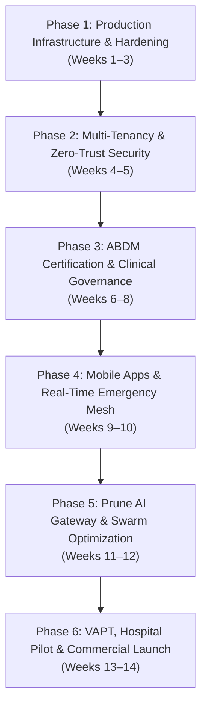

# JEEVIKA Enterprise Production Implementation Plan

> **Document Type:** Production Engineering & Clinical Go-Live Roadmap  
> **Author:** Jeevika Core Engineering Team &lt;engineering@jeevika.in&gt;  
> **Target Release:** JEEVIKA Enterprise 2.5.0-PROD  
> **Statutory Alignment:** Digital Personal Data Protection (DPDP) Act 2023, National Medical Commission (NMC) Act 2019, Ayushman Bharat Digital Mission (ABDM) Milestones 1–3, Indian Evidence Act Section 65B.

---

## 1. Executive Strategy & Production Scope

JEEVIKA is designed as a **Dual-Tier Hybrid Health Platform**:
1. **Hospital Enterprise SaaS Platform:** Central multi-tenant cloud subscription powering hospital administration, multi-branch inventory, CA double-entry financial suites, staff management, and clinical billing.
2. **Local-First Clinical Edge:** Lightweight on-premise edge gateway running within district hospitals and Primary Health Centres (PHCs) that operates 100% offline during internet cuts and synchronizes seamlessly with the central cloud.
3. **Role-Tailored Mobile Ecosystem:**
   - **Nurse Mobile Console:** Fast bed management, floor crash cart dispatch, and STAT deterioration reporting.
   - **Doctor On-Call Cockpit:** Real-time queue, Code Blue alerts, AI SOAP notes, and 1-click prescription cosigning.
   - **Patient Companion & Kiosk:** Vernacular triage, ABHA QR registration, follow-up timetable, and digital prescription access.

---

## 2. 6-Phase Phased Implementation Roadmap

---

## 3. Detailed Phase Breakdown & Engineering Work Packages

### Phase 1: Production Infrastructure & Hardening (Weeks 1–3)

* **Objective:** Establish automated, immutable, and reproducible cloud infrastructure with zero single points of failure.
* **Key Deliverables:**
  1. **Containerization & Distroless Execution:**
     - Finalize multi-stage production Dockerfiles utilizing Node 22 Alpine with unprivileged user execution (`UID 10001: GID 10001`).
     - Mount read-only root filesystems with ephemeral `/tmp` storage.
  2. **Infrastructure as Code (IaC):**
     - Author Terraform / OpenTofu modules for multi-AZ deployment on AWS (Mumbai `ap-south-1`) or Google Cloud (Delhi `asia-south2`).
     - Configure Managed Kubernetes (EKS / GKE) with Horizontal Pod Autoscaling (HPA) targeting 70% CPU and 75% memory.
  3. **High-Availability Database Layer:**
     - Deploy managed PostgreSQL 16 cluster with synchronous multi-AZ standby and automated WAL archiving to S3/GCS.
     - Integrate PgBouncer connection pooling to handle up to 2,000 concurrent client sessions.
  4. **Edge Outbox Engine:**
     - Implement transactional outbox queue in local SQLite with idempotent UUIDv5 batching to sync edge data to cloud with &lt;10s RPO.
* **Success Criteria:** Automated CI/CD deploys to staging within 5 minutes; zero container vulnerabilities detected by Trivy scanner.

---

### Phase 2: Multi-Tenancy, Auth & Zero-Trust Security (Weeks 4–5)

* **Objective:** Enforce strict data isolation between competing hospital networks and secure credentials under international and Indian privacy statutes.
* **Key Deliverables:**
  1. **Multi-Tenant Row-Level Security (RLS):**
     - Enforce PostgreSQL Row-Level Security on all entity tables (`patients`, `prescriptions`, `encounters`, `inventory_items`, `sales`).
     - Gated by `current_setting('app.current_hospital_id')` on every database connection.
  2. **Enterprise Authentication & Session Management:**
     - Replace localStorage token handling with secure, HTTP-only, SameSite=Strict cookies.
     - Implement short-lived Access Tokens (15 minutes) and cryptographically rotated Refresh Tokens (7 days).
     - Add Multi-Factor Authentication (TOTP / SMS OTP) for Doctor and Hospital Admin logins.
  3. **DPDP Act 2023 Statutory Compliance:**
     - Automated in-flight redaction of 12-digit Aadhaar numbers (`\b[2-9][0-9]{3}\s?[0-9]{4}\s?[0-9]{4}\b`) and 10-digit phone numbers before external routing.
     - Multilingual audio consent records stored with cryptographic timestamp and language code.
* **Success Criteria:** Passing security test suite verifying that Hospital A cannot access Hospital B records even with forged query parameters.

---

### Phase 3: ABDM Certification & Clinical Governance (Weeks 6–8)

* **Objective:** Achieve official Government of India accreditation under Ayushman Bharat Digital Mission (ABDM) and National Medical Commission (NMC) regulations.
* **Key Deliverables:**
  1. **ABDM Milestones 1, 2, and 3 Integration:**
     - **Milestone 1:** ABHA ID generation (Aadhaar OTP / Mobile OTP), QR-code verification, and patient linking.
     - **Milestone 2:** Health Information Provider (HIP) and Health Information User (HIU) capabilities with NRCeS-compliant FHIR R4 Bundles.
     - **Milestone 3:** Ayushman Bharat Health Facility Registry (HFR) and Healthcare Professionals Registry (HPR) directory syncing.
  2. **NMC Act 2019 Digital Prescription Protocol:**
     - Mandatory inclusion of Registered Medical Practitioner (RMP) license number (`#NMC-DL-2018-84729`) on all prescription artifacts.
     - Assistive AI guardrails: AI copilot recommendations remain purely advisory; prescriptions require explicit doctor PIN or biometric sign-off.
     - Schedule H/X narcotics override filter in Prune Clinical WAF.
  3. **Section 65B Indian Evidence Act Cryptographic Audit Vault:**
     - Every clinical action generates an HMAC-SHA256 chained audit record ensuring judicial admissibility in Indian courts.
* **Success Criteria:** Passing all National Health Authority (NHA) sandbox test cases with 100% compliance certificates for M1 and M2.

---

### Phase 4: Mobile Applications & Real-Time Emergency Mesh (Weeks 9–10)

* **Objective:** Deliver native-grade mobile experiences for floor nurses, on-call doctors, and discharged patients.
* **Key Deliverables:**
  1. **Cross-Platform Mobile Build (Capacitor / React Native):**
     - Package the responsive web codebase using Capacitor 6 to produce Android APK/AAB and iOS IPA bundles.
     - Configure offline caching with Service Workers and SQLite native bridge for zero-network resilience.
  2. **Sub-Second Code Blue Push Notifications:**
     - WebSockets clustering powered by Redis Pub/Sub for local LAN broadcast (&lt;50ms latency).
     - Apple Push Notification service (APNs) and Firebase Cloud Messaging (FCM) high-priority channels with distinct audible ringtones for Code Blue.
     - Critical SMS and automated voice IVR fallback via CDAC / Kaleyra gateway if doctor does not acknowledge within 30 seconds.
  3. **Patient Follow-Up Companion App:**
     - 1-click prescription sync via QR code scan.
     - Audio and visual medicine timetable in Hindi, Telugu, Bhojpuri, and English.
     - Direct follow-up appointment booking tied to hospital subscription entitlements.
* **Success Criteria:** Bedside SOS button press triggers nurse station audio chime in &lt;3 seconds and doctor push notification in &lt;5 seconds.

---

### Phase 5: Prune AI Gateway & Swarm Optimization (Weeks 11–12)

* **Objective:** Reduce ongoing hospital LLM operational expenditures by &gt;75% while maintaining strict data safety.
* **Key Deliverables:**
  1. **Production Semantic Vector Cache Cluster:**
     - Deploy Qdrant vector database with Cosine similarity threshold set to `0.94`.
     - Pre-seed vector index with 2,500 common rural and semi-urban OPD presentations.
  2. **Maritime Multi-Agent Swarm Cloud Sizing:**
     - Dedicated autoscaling worker pools for `agent-sentinel-01` (herb-drug interactions), `agent-vernacular-02` (audio-to-FHIR scribe), and `agent-supply-03` (Jan Aushadhi generic substitution).
     - Circuit breaker thresholds: If cloud latency exceeds 250ms, automatically engage local deterministic dictionaries without failing consultation requests.
  3. **Local Offline LLM Fallback:**
     - Provide an optional local quantized model (Llama-3-8B-Instruct 4-bit) running via Ollama on district hospital edge servers for air-gapped clinical operations.
* **Success Criteria:** Verification that hospital clusters save &gt;₹18,000/month in LLM token costs with sub-15ms cached response times.

---

### Phase 6: VAPT, Pilot Deployment & Commercial Launch (Weeks 13–14)

* **Objective:** Validate real-world hospital performance, ensure impenetrable security, and launch commercially.
* **Key Deliverables:**
  1. **CERT-In Accredited Vulnerability Assessment (VAPT):**
     - Commission external penetration testing covering OWASP Top 10, API security, privilege escalation, and HIPAA/DPDP data privacy.
  2. **Stress & Load Testing:**
     - Execute k6 distributed load tests simulating 10,000 daily OPD encounters, 500 concurrent doctor consultations, and 100 simultaneous Code Blue distress signals.
  3. **Hospital Pilot Rollout:**
     - Deploy to 2 District Hospitals and 5 rural Primary Health Centres (PHCs).
     - Train 40 nurses and 15 doctors; measure triage time reduction and adverse drug interaction prevention rates.
  4. **Commercial Billing & Subscription Activation:**
     - Stripe / Razorpay Subscriptions integration with automated GST invoicing and tiered hospital licensing.
* **Success Criteria:** Zero critical/high VAPT findings; 99.99% system availability throughout the 14-day continuous pilot.

---

## 4. Responsibility & Resource Allocation Matrix (RACI)

| Work Package | Lead Role | Supporting Team | Verification Artifact |
|:---|:---|:---|:---|
| **IaC & K8s Cluster Setup** | Lead DevOps Engineer | Cloud Architect | Terraform manifests, EKS cluster healthcheck |
| **PostgreSQL RLS & Multi-Tenancy** | Database Architect | Backend Lead | RLS audit test suite |
| **ABDM Milestone 1–3 Certification** | Health Informatics Lead | Compliance Officer | NHA Sandbox Compliance Certificate |
| **Mobile App Packaging & Push** | Mobile Engineer | Frontend Lead | Android AAB & iOS IPA in TestFlight/Internal Track |
| **Code Blue Real-Time Mesh** | Distributed Systems Lead | Network SRE | Redis Pub/Sub latency benchmark (&lt;50ms) |
| **Prune AI Gateway Deployment** | AI Infrastructure Lead | MLOps Engineer | Qdrant vector cache metrics (&gt;75% hit rate) |
| **VAPT Security Audit** | External CERT-In Auditor | Security Lead | Official VAPT Clean Clearance Report |

---

## 5. Risk Assessment & Mitigation Matrix

| Identified Risk | Probability | Severity | Mitigation Strategy |
|:---|:---:|:---:|:---|
| **Rural Internet Outages during OPD** | High | Critical | Local-First SQLite WAL engine operates autonomously offline; syncs via outbox queue once WAN is restored. |
| **Doctor Phone in Silent / Do Not Disturb** | High | Critical | APNs/FCM Critical Alerts entitlement bypasses DND; automated secondary SMS/IVR call triggered after 30 seconds. |
| **Adversarial Prompt Injection at Kiosk** | Medium | High | Prune Clinical WAF intercepts jailbreaks in &lt;9ms under HTTP 403; strict regex blocks Schedule H/X narcotics. |
| **Herb-Drug Interaction False Negative** | Low | Critical | Dual-layer validation: Local deterministic table of 140+ documented AYUSH collisions plus Maritime Cloud Sentinel swarm. |
| **ABHA Sandbox API Latency Fluctuation** | High | Medium | In-memory token caching and asynchronous background validation prevents kiosk queue blocking. |

---

## 6. Financial Model & Return on Investment (ROI)

* **Hospital Subscription Pricing:**
  - **Tier 1 (PHC / Clinic):** ₹4,999/month (Includes Kiosk, POS, Inventory, and Patient App).
  - **Tier 2 (District Hospital 50–100 Beds):** ₹24,999/month (Includes IPD Bedside Code Blue, Doctor Cockpit, and Prune Gateway).
  - **Tier 3 (Medical College / Multi-Branch):** ₹69,999/month (Includes Maritime Cloud Swarm, CA Suite, and Central Procurement).
* **Hospital Cost Recovery:**
  - Jan Aushadhi generic substitution saves patients up to 85% on medicine costs.
  - Prune Pro semantic caching cuts hospital LLM inference billing by ₹18,440/month per facility.
  - Triage red-flag intercept eliminates routine OPD line collapse, saving critical resuscitation bay minutes.
