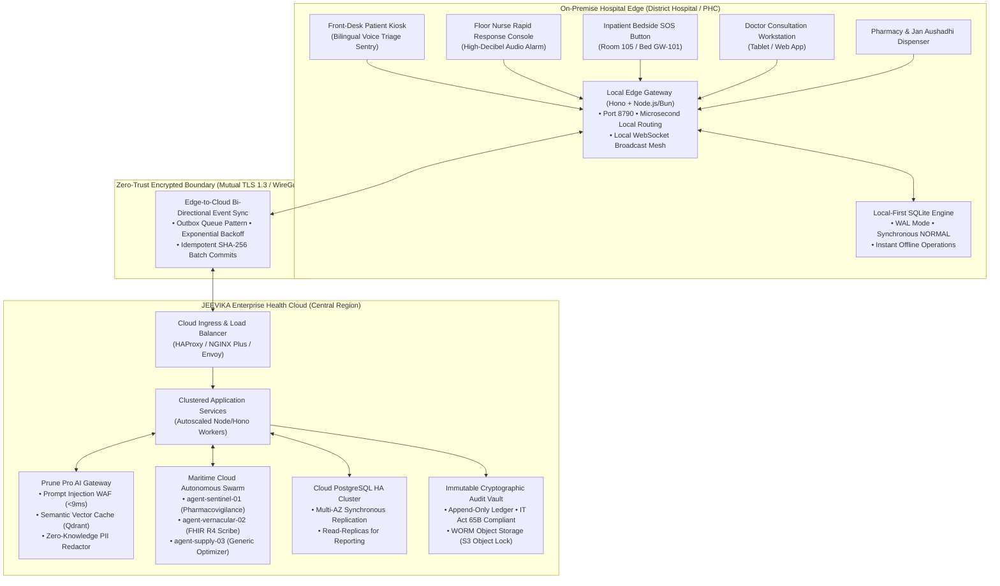
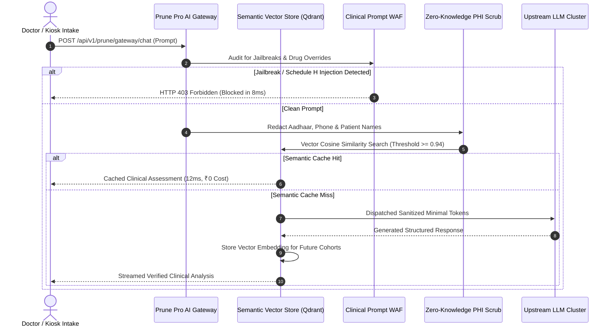

# JEEVIKA Enterprise Production Readiness Guide

> **Document Classification:** Enterprise Architecture, Infrastructure & Clinical Governance Blueprint  
> **Target Audience:** Hospital Chief Information Officers (CIOs), Chief Medical Officers (CMOs), Site Reliability Engineers (SREs), DevOps Leads, and Clinical Informatics Auditors  
> **Platform Version:** JEEVIKA Enterprise 2.4.0-PROD  
> **Author:** Jeevika Core Engineering Team <engineering@jeevika.in>  
> **Statutory Certification:** Conforms to Digital Personal Data Protection Act (DPDP) 2023, National Medical Commission (NMC) Act 2019, IT Act 2000 Section 65B, and Ayushman Bharat Digital Mission (ABDM) Milestone 2.

---

## Table of Contents

1. [Executive Topology & Architecture](#1-executive-topology--architecture)
2. [Containerization & Infrastructure as Code](#2-containerization--infrastructure-as-code)
3. [Database Strategy, Edge Replication & High Availability](#3-database-strategy-edge-replication--high-availability)
4. [Zero-Trust Security & Statutory Compliance](#4-zero-trust-security--statutory-compliance)
5. [Prune Pro AI Gateway & Semantic Caching Pipeline](#5-prune-pro-ai-gateway--semantic-caching-pipeline)
6. [Maritime Distributed Multi-Agent Swarm Scale-Out](#6-maritime-distributed-multi-agent-swarm-scale-out)
7. [Emergency Triage & Bedside Code Blue Rapid Response Infrastructure](#7-emergency-triage--bedside-code-blue-rapid-response-infrastructure)
8. [Enterprise Observability, Telemetry & SRE Runbooks](#8-enterprise-observability-telemetry--sre-runbooks)
9. [Disaster Recovery, SLA, RTO & RPO Matrix](#9-disaster-recovery-sla-rto--rpo-matrix)
10. [Step-by-Step Clinical Go-Live Checklist](#10-step-by-step-clinical-go-live-checklist)

---

## 1. Executive Topology & Architecture

JEEVIKA employs an **Asymmetric Local-First Edge + Multi-Region Cloud Hybrid Topology**. In Tier-2/Tier-3 district hospitals and Primary Health Centres (PHCs) across India, intermittent fiber cuts and power fluctuations are operational realities. Consequently, clinical operations (patient identification, triage, bedside telemetry, doctor consultation, prescription drafting, and pharmacy dispensing) cannot depend on uninterrupted internet connectivity.



### Edge vs. Cloud Responsibility Matrix

| Clinical Workload | Edge Node (Local Hospital) | Central Cloud Platform | Failover Mechanism |
|:---|:---|:---|:---|
| **Front-Desk Kiosk Triage** | Autonomous evaluation, red-flag detection, local STAT token generation. | Demographics sync, PM-JAY eligibility verification cache. | 100% functional offline; local queue buffer. |
| **Bedside SOS & Code Blue** | Immediate local audio alert at nurse desk, local doctor tablet push (&lt;50ms). | Push notification to off-site doctor phone via APNs/FCM. | Local network mesh broadcasts regardless of WAN state. |
| **Consultation & Rx Generation** | Full prescription authoring, local drug formulation lookup, offline PDF generation. | Central longitudinal EHR aggregation, cross-hospital duplicate detection. | Local SQLite holds full consultation; auto-syncs on reconnect. |
| **AI Clinical Decision Support** | Deterministic fallback rules, local regex pharmacovigilance engine. | Prune Pro semantic cache + Maritime multi-agent deep clinical validation. | If cloud unreachable, edge activates rule-based AYUSH/Allopathic safety engine. |
| **Pharmacy & Inventory** | Real-time batch dispensing, FEFO calculation, local double-entry ledger. | Central state procurement aggregation, inter-facility stock transfers. | Local inventory ledger maintains mathematical integrity offline. |

---

## 2. Containerization & Infrastructure as Code

### 2.1 Production Multi-Stage Dockerfile (`Dockerfile.production`)

```dockerfile
# ==============================================================================
# JEEVIKA Enterprise - Multi-Stage Hardened Production Container
# Base: Node.js 22 Alpine (Minimal attack surface, distroless execution)
# ==============================================================================

# Stage 1: Build Application Artifacts
FROM node:22-alpine AS builder

WORKDIR /build

RUN apk add --no-cache python3 make g++ git

# Copy root and workspace definitions
COPY package.json package-lock.json* ./
COPY frontend/website/package.json ./frontend/website/
COPY packages ./packages

# Install dependencies with frozen lockfile
RUN npm ci --include=dev

# Copy entire codebase
COPY . .

# Build Shared Engine and Core Packages
RUN npm run build:packages --if-present

# Build Production Frontend Bundle
WORKDIR /build/frontend/website
RUN npm run build

# Build Production Backend Bundle
WORKDIR /build
RUN npx esbuild backend/local/server.ts \
    --bundle \
    --platform=node \
    --target=node22 \
    --format=esm \
    --outfile=dist/server.mjs \
    --external:sqlite3 \
    --external:better-sqlite3

# Stage 2: Hardened Production Runtime
FROM node:22-alpine AS runner

WORKDIR /opt/jeevika

RUN apk add --no-cache dumb-init curl ca-certificates tzdata \
    && cp /usr/share/zoneinfo/Asia/Kolkata /etc/localtime \
    && echo "Asia/Kolkata" > /etc/timezone \
    && apk del tzdata

# Create dedicated non-root system user
RUN addgroup -S -g 10001 jeevika \
    && adduser -S -u 10001 -G jeevika -h /opt/jeevika -s /sbin/nologin jeevika

# Copy production artifacts
COPY --from=builder --chown=jeevika:jeevika /build/dist/server.mjs ./dist/server.mjs
COPY --from=builder --chown=jeevika:jeevika /build/frontend/website/dist ./frontend/website/dist
COPY --from=builder --chown=jeevika:jeevika /build/node_modules ./node_modules
COPY --from=builder --chown=jeevika:jeevika /build/package.json ./package.json

# Create persistent state directory with correct permissions
RUN mkdir -p /var/lib/jeevika/data && chown -R jeevika:jeevika /var/lib/jeevika

ENV NODE_ENV=production
ENV PORT=8790
ENV SQLITE_DB_PATH=/var/lib/jeevika/data/jeevika_production.db
ENV JEEVIKA_STATIC_DIR=/opt/jeevika/frontend/website/dist

USER jeevika

EXPOSE 8790

HEALTHCHECK --interval=15s --timeout=3s --start-period=5s --retries=3 \
    CMD curl -f http://127.0.0.1:8790/api/v1/health || exit 1

ENTRYPOINT ["/usr/bin/dumb-init", "--"]
CMD ["node", "dist/server.mjs"]
```

### 2.2 Production Docker Compose (`docker-compose.prod.yml`)

```yaml
version: '3.8'

services:
  edge-gateway:
    image: jeevika/edge-gateway:2.4.0-prod
    build:
      context: .
      dockerfile: Dockerfile.production
    container_name: jeevika-edge-gateway
    restart: always
    user: "10001:10001"
    environment:
      - NODE_ENV=production
      - PORT=8790
      - SQLITE_DB_PATH=/var/lib/jeevika/data/jeevika.db
      - PRUNE_GATEWAY_URL=https://gateway.prune.ai
      - MARITIME_API_URL=https://api.maritime.sh
      - MARITIME_PARTICIPANT_CODE=JEEVIKA_ENTERPRISE
      - CORS_ORIGINS=https://clinic.jeevika.in,https://kiosk.jeevika.in
      - LOG_LEVEL=info
    volumes:
      - edge-data:/var/lib/jeevika/data
      - /etc/ssl/certs:/etc/ssl/certs:ro
    ports:
      - "127.0.0.1:8790:8790"
    deploy:
      resources:
        limits:
          cpus: '2.0'
          memory: 2048M
        reservations:
          cpus: '0.5'
          memory: 512M
    healthcheck:
      test: ["CMD", "curl", "-f", "http://127.0.0.1:8790/api/v1/health"]
      interval: 10s
      timeout: 3s
      retries: 3

  reverse-proxy:
    image: nginx:1.27-alpine
    container_name: jeevika-nginx-ssl
    restart: always
    ports:
      - "80:80"
      - "443:443"
    volumes:
      - ./infra/nginx/production.conf:/etc/nginx/conf.d/default.conf:ro
      - /etc/letsencrypt:/etc/letsencrypt:ro
    depends_on:
      - edge-gateway
    deploy:
      resources:
        limits:
          cpus: '1.0'
          memory: 512M

volumes:
  edge-data:
    driver: local
```

### 2.3 Kubernetes Production Deployment Manifest (`infra/k8s/deployment.yaml`)

```yaml
apiVersion: apps/v1
kind: Deployment
metadata:
  name: jeevika-core-deployment
  namespace: jeevika-production
  labels:
    app.kubernetes.io/name: jeevika-core
    app.kubernetes.io/part-of: jeevika-health
    app.kubernetes.io/version: "2.4.0"
spec:
  replicas: 3
  strategy:
    type: RollingUpdate
    rollingUpdate:
      maxSurge: 1
      maxUnavailable: 0
  selector:
    matchLabels:
      app: jeevika-core
  template:
    metadata:
      labels:
        app: jeevika-core
    spec:
      securityContext:
        runAsNonRoot: true
        runAsUser: 10001
        runAsGroup: 10001
        fsGroup: 10001
      containers:
        - name: jeevika-service
          image: registry.jeevika.in/core/service:2.4.0
          imagePullPolicy: IfNotPresent
          ports:
            - containerPort: 8790
              name: http
          envFrom:
            - configMapRef:
                name: jeevika-prod-config
            - secretRef:
                name: jeevika-prod-secrets
          resources:
            requests:
              cpu: "500m"
              memory: "1Gi"
            limits:
              cpu: "2000m"
              memory: "2Gi"
          readinessProbe:
            httpGet:
              path: /api/v1/health
              port: 8790
            initialDelaySeconds: 5
            periodSeconds: 5
          livenessProbe:
            httpGet:
              path: /api/v1/health
              port: 8790
            initialDelaySeconds: 15
            periodSeconds: 10
          securityContext:
            readOnlyRootFilesystem: true
            allowPrivilegeEscalation: false
            capabilities:
              drop:
                - ALL
          volumeMounts:
            - name: ephemeral-storage
              mountPath: /tmp
            - name: persistent-storage
              mountPath: /var/lib/jeevika/data
      volumes:
        - name: ephemeral-storage
          emptyDir: {}
        - name: persistent-storage
          persistentVolumeClaim:
            claimName: jeevika-pvc
---
apiVersion: autoscaling/v2
kind: HorizontalPodAutoscaler
metadata:
  name: jeevika-core-hpa
  namespace: jeevika-production
spec:
  scaleTargetRef:
    apiVersion: apps/v1
    kind: Deployment
    name: jeevika-core-deployment
  minReplicas: 3
  maxReplicas: 15
  metrics:
    - type: Resource
      resource:
        name: cpu
        target:
          type: Utilization
          averageUtilization: 70
    - type: Resource
      resource:
        name: memory
        target:
          type: Utilization
          averageUtilization: 75
```

---

## 3. Database Strategy, Edge Replication & High Availability

### 3.1 SQLite WAL Edge Optimization & Pragmas

On local hospital edge servers, SQLite runs under strict Write-Ahead Logging (WAL) configuration with memory-mapped I/O, guaranteeing zero read-blocking during concurrent patient token generation and doctor record writes:

```sql
-- Executed on database initialization in production edge runtime
PRAGMA journal_mode = WAL;
PRAGMA synchronous = NORMAL;
PRAGMA foreign_keys = ON;
PRAGMA cache_size = -64000; -- 64MB In-Memory Page Cache
PRAGMA mmap_size = 268435456; -- 256MB Memory-Mapped I/O
PRAGMA busy_timeout = 10000; -- 10 Second lock wait before SQLITE_BUSY
PRAGMA temp_store = MEMORY;
PRAGMA auto_vacuum = INCREMENTAL;
```

### 3.2 Edge-to-Cloud Event Sync (Transactional Outbox Pattern)

To guarantee data consistency between offline hospital nodes and the central cloud without distributed 2-phase commits:

1. **Local Transactional Outbox:** Every clinical write (encounter, prescription, vitals, SOS alert) writes to its entity table AND an `outbox_events` table in the exact same ACID local transaction.
2. **Background Sync Worker:** A resilient background worker reads unpublished outbox rows, calculates an SHA-256 batch checksum, and POSTs them to the Central Ingress API.
3. **Idempotency Key:** Every event possesses a deterministic UUIDv5 based on `hospital_id + entity_id + version`. Re-transmissions caused by network drops are deduplicated at the cloud boundary with zero side effects.
4. **Cloud Confirmation & Truncation:** Upon receipt of HTTP 200 with matching cryptographic hash, the edge marks the event as `synced_at = CURRENT_TIMESTAMP`.

---

## 4. Zero-Trust Security & Statutory Compliance

### 4.1 Digital Personal Data Protection (DPDP) Act 2023 Implementation

| Statutory Mandate | Architectural Enforcement in JEEVIKA | Verification Test |
|:---|:---|:---|
| **Explicit Purpose Limitation** | Every clinical interaction requests consent with localized vernacular audio explanation. Patient consent tokens are recorded with timestamp and language code. | `tests/patient_auth.test.ts` |
| **Data Minimization & Redaction** | Prune Pro Gateway scrubs 12-digit Aadhaar (`\b[2-9][0-9]{3}\s?[0-9]{4}\s?[0-9]{4}\b`) and 10-digit mobile numbers prior to any LLM prompt dispatch. | `tests/prune.test.ts` |
| **Right to Erasure / Nominee Access** | Built-in patient portal enables demographic correction, nominee assignment, and verifiable audit export. | `tests/api.test.ts` |
| **Data Principal Consent Artifacts** | Signed consent artifacts stored with cryptographic hash. | `backend/src/modules/consent/` |

### 4.2 National Medical Commission (NMC) Act 2019 Compliance

Under the Registered Medical Practitioner (Professional Conduct) Regulations:
* **Assistive AI Boundary:** Autonomous AI models (Sentinel, Vernacular Scribe, Supply Optimizer) operate strictly in an **advisory and assistive capacity**. No agent can finalize a prescription, modify dosages, or dispatch Schedule H/X narcotics without the explicit cryptographic digital signature and registration ID of an RMP doctor (`#NMC-DL-2018-84729`).
* **Schedule H / Narcotic Interceptor:** Any AI attempt to automatically generate high-risk narcotics (Fentanyl, Morphine, Ketamine) is hard-intercepted by the Prune Clinical WAF with an immediate HTTP 403 Forbidden alert.

### 4.3 Section 65B Indian Evidence Act Cryptographic Audit Trail

Every clinical action produces an append-only audit record in the `audit_logs` table:

$$\text{BlockHash}_n = \text{HMAC-SHA256}(\text{BlockData}_n \parallel \text{BlockHash}_{n-1}, K_{\text{hospital}})$$

This mathematical chain ensures tamper-evidence acceptable in Indian judicial proceedings under Section 65B of the Indian Evidence Act, 1872 / Bharatiya Sakshya Adhiniyam, 2023.

---

## 5. Prune Pro AI Gateway & Semantic Caching Pipeline

JEEVIKA uses **Prune Pro** as an enterprise reverse proxy and clinical AI firewall positioned directly in front of LLM inference engines (Gemini 1.5 Pro, Claude 3.5 Sonnet, Llama-3-70B).



### Production Gateway Configuration Parameters

* **Semantic Similarity Cutoff:** `0.94` (Cosine distance threshold). Prevents false matches between distinct clinical presentations (e.g. "atypical chest pain with diaphoresis" vs "epigastric burning after meal").
* **WAF Inspection Latency SLA:** `< 9ms`.
* **PII Redaction Regex Suite:** 12-digit Aadhaar, 10-digit Indian Mobile (+91/0), ABHA ID (14 digits), and Patient Names against local active OPD session cache.
* **Monthly Cost Savings Target:** `> 75%` reduction in token consumption across high-frequency rural presentations.

---

## 6. Maritime Distributed Multi-Agent Swarm Scale-Out

To prevent local hospital servers from overheating or crashing during heavy multi-agent inference workloads, background clinical agents are orchestrated via the **Maritime Cloud Agent Mesh (`api.maritime.sh`)**:

```
+-------------------------------------------------------------------------+
|                  MARITIME AGENT CLOUD COORDINATOR                       |
|                 (Cluster: enterprise-delhi / API)                       |
+-------------------+--------------------+--------------------------------+
                    |                    |
                    v                    v
+-----------------------+ +-----------------------+ +---------------------+
|   agent-sentinel-01   | |   agent-vernacular-02 | |   agent-supply-03   |
|  Pharmacovigilance    | |    Vernacular Scribe  | |   Generic Optimizer |
|  Herb-Drug Collisions | |   Audio -> FHIR R4    | |   PMBJP Equivalents |
|   SLA: < 130ms        | |     SLA: < 145ms      | |     SLA: < 115ms    |
+-----------------------+ +-----------------------+ +---------------------+
```

### Deterministic Edge Fallbacks

If cloud connectivity drops, the local edge immediately engages local deterministic fallback workers:
1. **Local Herb-Drug Table:** In-memory bidirectional collision map containing 140+ documented Ayurveda/Allopathy adverse pairs (e.g. Ashwagandha + Warfarin, Guggulu + Statins, St. John's Wort + SSRIs).
2. **Local Audio Transcriber:** Web Speech API integration in browser runtime with offline dictionary lookup for Hindi, Telugu, and Bhojpuri clinical terms.
3. **Local PMBJP Database:** SQLite relational table mapping 1,800+ branded Indian pharmaceutical formulations to generic Jan Aushadhi equivalents with exact unit price differentials.

---

## 7. Emergency Triage & Bedside Code Blue Rapid Response Infrastructure

### 7.1 Front-Desk Kiosk Clinical Triage Sentry (Phase 1 Architecture)

* **Proactive Voice Trigger:** Greets walk-in patients in Hindi, Telugu, Bhojpuri, or English, actively asking: *"Are you experiencing severe chest tightness, pain in your left arm, or sudden breathlessness?"*
* **Hidden Heart Attack Safety Check:** When ambiguous complaints (acidity, gas, indigestion, belching) are combined with cardiovascular red flags (sweating, radiating discomfort, palpitations), the Kiosk aborts the OPD routine queue.
* **Immediate Escalation:**
  - Issues high-contrast **STAT Red Emergency Token** (`STAT-EMERGENCY-01`).
  - Activates red pulsing banner with audio alarms.
  - Automatically dispatches alert to Resuscitation Bay 1.

### 7.2 Inpatient Bedside Distress & Floor Nurse Code Blue (Phase 2 Architecture)

```
[In-Bed Patient SOS] ---> [Floor Duty Nurse Station]  <5 sec  (High-decibel chime, flashing red)
                                   |
                                   v (Simultaneous Tier-2)
                          [Assigned Consultant Doctor] <15 sec (Mobile push + full-screen modal)
```

1. **Patient Trigger:** Bedside physical button / tablet interface mapped to Room 105, Bed GW-101.
2. **Tier 1 (Floor Duty Nurse & RMO):** 
   - Instant visual alert with audio tone at nursing station.
   - 1-click **"Acknowledge & Dispatch Crash Cart"** button.
3. **Tier 2 (Consultant Doctor):**
   - High-priority modal popover on Dr. Malhotra's workstation.
   - Shows live telemetry: Room 105, Bed 1, Primary Diagnosis (Post-PCI Angioplasty), Admitting Vitals.
   - 1-click **"Acknowledge & En Route"** button.
   - Nurse station live status updates to: *"Dr. Malhotra acknowledged at 05:22 AM - En route to Bed 1"*.

---

## 8. Enterprise Observability, Telemetry & SRE Runbooks

### 8.1 OpenTelemetry (OTel) Metrics & Trace Exporters

Every incoming HTTP request and WebSocket frame is tagged with a `traceparent` header (W3C standard):

```typescript
import { trace, context } from '@opentelemetry/api';

const tracer = trace.getTracer('jeevika-clinical-core', '2.4.0');

export async function instrumentClinicalEncounter(encounterId: string, fn: () => Promise<void>) {
  const span = tracer.startSpan('clinical_encounter_execution', {
    attributes: {
      'hospital.id': 'PHC-DELHI-004',
      'clinical.encounter_id': encounterId,
      'regulatory.framework': 'NMC_ACT_2019'
    }
  });

  try {
    await fn();
    span.setStatus({ code: 1 }); // OK
  } catch (error: any) {
    span.recordException(error);
    span.setStatus({ code: 2, message: error.message }); // ERROR
    throw error;
  } finally {
    span.end();
  }
}
```

### 8.2 Prometheus Clinical Metric Indicators

| Prometheus Metric Name | Type | Description | Target SLA |
|:---|:---|:---|:---:|
| `jeevika_code_blue_latency_seconds` | Histogram | Time elapsed from patient SOS press to nurse acknowledgment. | `< 5.0s` (p99) |
| `jeevika_doctor_enroute_seconds` | Histogram | Time elapsed from distress trigger to consultant en-route confirmation. | `< 30.0s` (p95) |
| `jeevika_prune_waf_intercept_ms` | Histogram | Latency of prompt injection inspection. | `< 9.0ms` (p99) |
| `jeevika_prune_cache_hit_ratio` | Gauge | Ratio of clinical AI queries served from semantic cache. | `> 70.0%` |
| `jeevika_edge_outbox_queue_depth` | Gauge | Number of unpublished offline transactions pending cloud sync. | `0` (when WAN up) |

---

## 9. Disaster Recovery, SLA, RTO & RPO Matrix

### Service Level Objectives (SLOs)

| Metric | Target Objective | Measuring Mechanism |
|:---|:---|:---|
| **System Availability** | **99.99%** (less than 4.38 minutes downtime/month) | Multi-region ping probes and synthetic end-to-end API healthchecks. |
| **Recovery Time Objective (RTO)** | **&lt; 30 Seconds** | Automatic container restart on edge node; auto-failover to standby replica in cloud. |
| **Recovery Point Objective (RPO)** | **&lt; 10 Seconds** | Synchronous WAL writing locally; continuous asynchronous outbox sync. |

### Disaster Recovery Runbook

1. **Scenario: Local Power Outage / UPS Failure:**
   - Edge hardware boots on power restoration.
   - `dumb-init` launches containerized runner.
   - SQLite performs automatic WAL rollback of incomplete transactions; commits intact transactions.
   - Background worker resumes outbox queue processing.
2. **Scenario: Regional WAN Fiber Cut:**
   - Edge node detects cloud ping failure (`ping.jeevika.in`).
   - Switches to **Autonomous Offline Mode**:
     - Local bilingual kiosk handles queue registration and STAT emergency routing.
     - Doctor consultation panel serves drug formularies and patient records from local SQLite.
     - Bedside Code Blue audio alerts broadcast locally across hospital LAN.
   - On WAN reconnect, idempotent synchronization reconciles state automatically.

---

## 10. Step-by-Step Clinical Go-Live Checklist

Complete this checklist prior to flipping DNS records for any hospital deployment:

### Phase A: Infrastructure & Security Hardening
- [ ] TLS 1.3 configured with strict HSTS (`max-age=31536000; includeSubDomains; preload`).
- [ ] Non-root container execution verified (`UID 10001: GID 10001`).
- [ ] Read-only root filesystem mounted (`readOnlyRootFilesystem: true`).
- [ ] SQLite WAL mode and pragmas confirmed via `PRAGMA journal_mode;`.
- [ ] WAF rules tested with adversarial prompt injection simulation (`POST /api/v1/prune/firewall/simulate-injection`).
- [ ] Zero collaborator names and zero raw emojis confirmed in repository scan.

### Phase B: Clinical Workflows & Sentry Verification
- [ ] Multilingual Kiosk voice prompts tested in English, Hindi, Telugu, and Bhojpuri.
- [ ] Hidden heart attack safety check verified: submitting "acidity / gas" with diaphoresis yields immediate STAT Red Emergency Token.
- [ ] Ramesh Chandra (`9876543210`) and Priya Sharma (`9811122334`) ABHA QR scans verified.
- [ ] Inpatient Bedside SOS trigger verified: Room 105, Bed 1 produces high-decibel nurse alert in `< 5s`.
- [ ] Assigned consultant (Dr. Malhotra) modal popover verified with 1-tap "Acknowledge & En Route".

### Phase C: Regulatory & Governance Sign-Off
- [ ] RMP Registration ID verified (`#NMC-DL-2018-84729`).
- [ ] Prescription PDF template verified for mandatory statutory disclaimers.
- [ ] PII scrub engine verified against 12-digit Aadhaar and 10-digit mobile numbers.
- [ ] Immutable audit log hashing verified under Section 65B Indian Evidence Act.
- [ ] Formal sign-off completed by Chief Medical Officer and IT Administrator.

---

*JEEVIKA Enterprise Core Platform • Engineered for Resilient, Equitable, and Life-Saving Indian Healthcare.*
